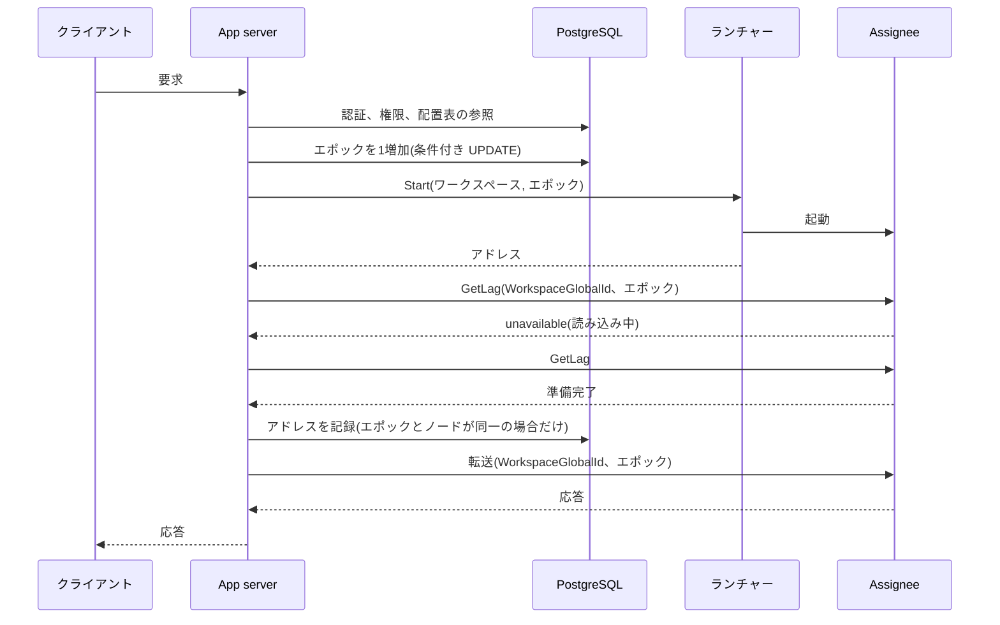

# 配置表の条件付き UPDATE がエポックを発行し、Assignee のプロセスは1個のエポックだけを処理する

- 決定日: 2026-11-14
- 状態: 採用
- 関連: #171、#191、#81、#104、#111、#139、#184、#194

## 背景

[ワークスペース](../../GLOSSARY.md#ワークスペース)ごとに、変更を受理して[変更ログ](../../GLOSSARY.md#変更ログ)に確定するサーバーが [Assignee](../../GLOSSARY.md#変更ログ) である。要求の転送先の Assignee は、1個のワークスペースに1個でなければならない。

変更ログの整合性は、S3 の条件付き書き込みとフェンスが保証する。ADR 0006 の決定は次のとおりである。1個の Slot には If-None-Match で1回だけ書き込む。新規の Assignee は受理の開始前に次の Slot へフェンスを書き込み、古い Assignee の以後の書き込みを失敗させる。この仕組みは、Assignee ごとに一意で単調増加する[エポック](../../GLOSSARY.md#変更ログ)を前提にする。ADR 0006 は、再起動した Assignee も新規のエポックを取得すると規定したが、エポックの発行の方式は決定しなかった([ADR 0006](0006-change-log-writes-are-conditional-and-read-back.md))。

この ADR の以前は、Assignee がエポックの既定値を起動時の時刻から生成していた。S3 のキーはワークスペースの名前であった。

解決する問題は次の4点である。

- エポックをどこで一意に、単調増加で発行するか。
- App server が各要求をどの Assignee へ転送するか。ノードはポートを再利用するので、古いアドレスは別のワークスペースの Assignee を指示しうる。
- Assignee の障害、アイドルによる終了、deploy による入れ替えを、どの契機で検出し、どの手順で交代させるか。
- 顧客のオンプレ環境でも、SaaS 環境と同一の構成で稼働させること。

前提として、停止中のワークスペースへの最初の要求は、5〜10秒の待機を許容する。

### 用語

[配置表](../../GLOSSARY.md#配置表)、配置コントローラー、ランチャー、ノード、読み込み中、準備完了は GLOSSARY.md の定義に従う。以下は GLOSSARY.md に存在しない用語である。

- **App server**: クライアントの要求を受信し、認証と権限の確認の後に Assignee へ転送するサーバー。状態を保持せず、複数台で稼働する。
- **アドレスのエポック**: 配置表に記録したアドレスの Assignee が処理するエポック。
- **起動中**: 配置表の行で、最後に発行したエポックがアドレスのエポックより大きい状態。
- **停止中**: 配置表の行で、アドレスが空で、起動中でない状態。
- **準備の確認**: App server が Assignee へ副作用のない `GetLag` を送信し、正常な応答を受領すること。正常な応答は準備完了を意味する。
- **稼働中の交代**: 古い Assignee の稼働中に新規の Assignee を起動し、アドレスの記録で転送先を切り替える交代。
- **連続失敗**: 記録から10分以内の交代と、記録に到達しなかった交代。
- **Quint**: 形式仕様の言語。この設計のモデルは [`storage/quint/placement.qnt`](../../storage/quint/placement.qnt) である。

## 決定事項

App server、配置表、ランチャー、Assignee を以下の構成で接続する。期限、回数、間隔はすべて暫定値で、計測後に確定する。配置表の SQL の正は [`storage/placement/src/lib.rs`](../../storage/placement/src/lib.rs)、表の定義の正は [`0001_placement.sql`](../../storage/placement/migrations/0001_placement.sql) である。

### 配置表とエポックの発行

- **配置表は PostgreSQL の表で、1個のワークスペースが1行である**。 行は WorkspaceGlobalId、最後に発行したエポック、起動先のノード、発行時刻、アドレス、アドレスのエポック、記録時刻、前回の起動時間、連続失敗回数を保持する。行はワークスペースの作成と同一のトランザクションで作成し、エポックの初期値は 0 である。時刻はすべて PostgreSQL の `now()` で、App server の時計を使用しない。
- **配置コントローラーは独立したプロセスにせず、App server 内の module とする**。 PostgreSQL に接続するのは App server だけである。
- **エポックは、主キーで指定した1行への条件付き UPDATE で1増加させる(#104)**。 App server は Assignee を起動する直前に発行し、返却された値を使用する。条件は次の4点である。
  - 行のエポックが、直前に読み取った値と一致する。
  - 行のアドレスのエポックが、直前に読み取った値と一致する。
  - 発行時刻から待機時間が経過している。待機時間は、起動中の行では起動期限と backoff の長い方、起動中でない行では backoff である。
  - 計画的な入れ替えは、起動中でない行だけを対象にし、待機時間は 0 である。
- **更新が0行の場合、App server は理由を区別せず配置表を再度参照する**。
- **発行と記録は autocommit の READ COMMITTED の1文で実行する**。 呼び出し側のトランザクションに含めない。App server は ReadyForQuery まで読み取ってから、発行したエポックを使用する。
- **エポックの発行はアドレスを消去しない**。 新規の Assignee を記録するまで、要求は古い Assignee へ転送する。
- **エポックの減少、主キーの変更、行の削除、TRUNCATE は、表の trigger が拒否する**。

### Assignee のプロセス

- **Assignee のプロセスは、1個のワークスペースの1個のエポックだけを処理する**。 `--workspace` と `--epoch` を必須の引数とし、時刻による既定値を廃止する。Assignee が停止するとプロセスも終了し、同一プロセスでは再開しない。
- **Assignee は PostgreSQL に接続しない**。 S3 に接続するのは Assignee だけである。
- **Assignee は起動直後に listen を開始し、フェンスの書き込みが完了するまで全操作に `unavailable` を返却する(#111)**。 `GetLag` も対象である。
- **Assignee は、自分の引数と WorkspaceGlobalId またはエポックが一致しない要求を `failed_precondition` で拒否する**。

### ランチャー

- **プロセスの起動と停止は、ノードごとのランチャーが実行する**。 契約は `Start`、`Stop`、`Find` の3操作で、引数はワークスペースとエポックである。契約は `proto/` に配置する。`Start` と `Find` は listen 中のアドレスを返却する。
- **同一のワークスペースとエポックのプロセスが稼働中の場合、ランチャーは `Start` を拒否する**。 拒否された App server は `Find` でアドレスを取得する。
- **ランチャーは PostgreSQL と S3 のどちらにも接続しない**。
- **結果が不明な `Start` は再送しない**。 App server は新規のエポックを発行して起動を再実行し、結果が不明なエポックには `Stop` を1回だけ送信する。`Stop` は失敗しても再送しない。

### アドレスの記録と転送

- **アドレスの記録は、準備の確認の後に実行する**。 App server は記録の後に要求を転送し、記録前の Assignee へは書き込みを送信しない。準備の確認で、`unavailable` は読み込み中を意味し、`failed_precondition` と接続の失敗は該当のプロセスの不在を意味する。
- **記録の UPDATE は、エポックとノードが行と一致する場合だけ成功する**。 同一のエポックの2回目の記録も成功するが、記録時刻と前回の起動時間は最初の値を保持する。記録が0行の場合は、起動した Assignee へ `Stop` を送信し、配置表を再度参照する。
- **App server は要求ごとに配置表を参照し、内容を cache しない**。 転送先は行のアドレスだけで、WorkspaceGlobalId とアドレスのエポックを付与する。`failed_precondition` で拒否された場合は、配置表を再度参照して1回だけ再試行する。
- **App server は、`unavailable` を受領した要求と失敗した書き込みを10秒まで再試行する**。 再試行は同一の Request ID を使用する。超過した場合はクライアントへ `unavailable` を返却する。
- **起動中の行へ到着した要求は、行のアドレスへ転送する**。 アドレスが空の場合と、接続の失敗か `failed_precondition` を受領した場合は、記録まで配置表を polling して待機する。上限は10秒である。

停止中のワークスペースへの最初の要求は、以下の順序で処理する。

### 障害の検出と交代

- **障害は要求を契機に検出し、heartbeat とリースは導入しない**。 交代を開始する条件は以下の5個だけで、応答の遅延だけでは交代しない。
  1. 行が停止中である。
  2. 行が起動中でなく、Assignee への接続が、短い間隔の数回の試行ですべて失敗した。
  3. 行が起動中でなく、配置表を再度参照した後の要求も `failed_precondition` で拒否された。
  4. 行が起動中のまま、発行時刻から起動期限を超過した。
  5. 行が起動中で、ランチャーが返却したアドレスのプロセスの終了を確認した。準備の確認が `failed_precondition` なら終了と判定する。接続の失敗なら `Find` を送信し、不在が返却された場合だけ終了と判定する。アドレスを取得していない App server が `Find` で不在を受領した場合は対象外である。
- **起動中の行は、どの App server も起動を完了させられる**。 起動中の行を参照した App server は、起動先のノードのランチャーへ `Find` を送信し、アドレスが返却された場合は準備の確認と記録を代行する。
- **起動期限は、前回の起動時間の2倍を基準値にし、連続失敗回数に応じて2倍ずつ延長する**。 基準値の下限は30秒、期限の上限は30分である。前回の起動時間は発行から記録までの時間で、負になる場合は 0 を保存する。
- **連続失敗を計数し、次回の発行を backoff で遅延させる(#81)**。 計数と遅延は発行の UPDATE の内部で実行する。backoff は、回数が 0 なら 0、1 以上なら 1秒 × 2^(回数 − 1) で、上限は5分である。記録から10分以上が経過した交代は回数を 0 に更新し、計画的な入れ替えは回数を変更しない。遅延中の要求には `unavailable` を返却し、連続失敗をログに出力する。
- **アイドルによる終了の期限は、準備完了後の最後の要求を起点にし、10分以上とする**。

### 入れ替え

- **Assignee、App server、ランチャーの入れ替えは、障害時の交代と同一の規則で実行し、専用の状態を追加しない**。 Assignee の入れ替えは、新規のエポックの発行、移動先への `Start`、準備の確認、記録、古い Assignee への `Stop` の順序で実行する。発行がアドレスを消去しないので、記録まで古い Assignee が要求を処理する。
- **ランチャーの更新は、最初の実装ではノードの交換として実行する**。 ランチャーの再起動は、子プロセスとして起動したそのノードの全 Assignee を停止させるからである。
- **App server は1台ずつ入れ替える**。 停止する App server は新規の要求の受信を終了し、処理中の要求の完了を10秒より長い上限まで待機する。

手順は [`docs/runbooks/placement-replacement.md`](../runbooks/placement-replacement.md) に記載する。

### バージョンの混在

本番環境の稼働後は、入れ替えの順序を自由にし、rollback を可能にするため、以下の規則を適用する。本番環境が存在しない期間は対象外で、互換を維持せず形式と契約を変更する(セグメントの形式バージョン 2、payload のバージョン 2、HTTP の座標(#184) はこの期間の変更である)。

- App server と Assignee の間、App server とランチャーの間の契約は、隣接する2個のバージョンで互換にする。変更はフィールドの追加だけとする。
- 配置表の列の変更は、追加、移行、削除の3回の deploy に分割する。
- Assignee が書き込むセグメントと snapshot の形式バージョンは、起動時の設定で指定する。設定の引き上げは全バイナリの更新の後に実行する。この仕組みは未実装である(#194)。payload は固有のバージョンを保持し、payload の変更はセグメントの形式バージョンを変更しない。
- 形式バージョンごとに、固定のバイト列による読み取りの試験を保持する。
- rollback は、古いバージョンを移動先にした入れ替えである。

### 配置表の PostgreSQL の構成

- **確定済みの更新が切り替えで消失しない構成を必須とする**。 SaaS 環境は、ストレージが複数の AZ に同期で複製される形式を使用する。配置表の参照と更新はプライマリ(Aurora では writer endpoint)だけに送信し、読み取り専用のエンドポイントと standby は参照しない。
- **オンプレ環境でレプリカを配置する場合は、以下の3点を必須とする**。 App server はこの要件への違反を検出できない。
  - `synchronous_commit` を `on` 以上に設定し、セッションごとの緩和を禁止する。
  - 同期の standby が不在でも、非同期へ自動で降格させない(Patroni では `synchronous_mode_strict`)。
  - 昇格の対象を同期の standby に限定する。
- **行のエポックの減少と、発行済みのエポックを指定したプロセスの再起動を禁止する**。 復元と切り替えの後は、App server を停止し、全行のエポックを補正する UPDATE(`correct_after_restore`)を実行してから再開する。手順は [`docs/runbooks/placement-recovery.md`](../runbooks/placement-recovery.md) に記載する。

### その他の構成

- **App server は Rust で実装する**。 契約(`proto/`)から生成した型を Assignee と共有する。Connect の実装には `connectrpc` crate を使用する。
- **ワークスペースの ID は WorkspaceGlobalId(ULID)とし、App server が作成時に発行する(#139)**。 S3 のキーの先頭は WorkspaceGlobalId で、名前は表示専用である。`--workspace` が ULID でない場合、Assignee は起動を中止する。
- **オンプレ環境で必須にする構成は、PostgreSQL、条件付き書き込みに適合する S3 互換ストア、1台以上のノードの3点だけである**。 Kubernetes は必須にしない。Kubernetes を標準の基盤にする顧客には、Pod を作成するランチャーの実装を追加して対応する。

### 最初の実装の範囲

最初の実装では、ランチャーを App server 内の interface とローカル実装にし、App server を1台に限定する。App server の再起動で全 Assignee が停止し、新規のエポックで起動する。`Find` による記録の代行とアイドルによる終了は導入せず、残存したプロセスはランチャーが強制終了で回収する。ランチャーを独立したプロセスへ分離する時点は、複数ノード化か、App server の更新で Assignee を停止できなくなった時点である。

### 範囲外

- ノードの選択方法、Assignee がアイドルで終了する条件、同時に起動する個数の上限。ノードのメモリ配置の ADR(番号 0007 を予約済み)で決定する。最初は1ノードとし、ランチャーのアドレスは App server の設定に記述する。
- App server、Assignee、ランチャーの間の認証。WorkspaceGlobalId とエポックの照合は認証ではない。当面はネットワークの分離を前提にする。認証の構成は認証の ADR(番号 0009 を予約済み)で決定する。
- ワークスペースの削除に伴う行と S3 のデータの削除。
- App server のリポジトリ内の配置場所。
- メトリクスと通知の基盤。連続失敗の通知先は当面ログだけである。

## 理由

### 根拠の種類

規則の一部は、Quint のモデルで規則を1個ずつ除外し、性質に違反することを確認した。モデルが検査する性質は、エポックの一意性(1個のエポックで起動するプロセスは高々1個)、エポックの単調性、読み取りの鮮度(読み取りの応答は、配置表の参照時点で ACK 済みのコミットをすべて含む)、ワークスペースの分離の4個である。ADR 0006 の変更ログの性質は、エポックの一意性を前提にする。

- モデルの根拠がある規則: 発行の UPDATE のエポックの条件、`Start` を再送しない規則、WorkspaceGlobalId とエポックの照合、配置表を cache しない規則、転送先を行のアドレスに限定する規則、準備の確認の後の記録、記録の UPDATE のノードの条件、重複した `Start` の拒否、発行がアドレスを消去しない規則(入れ替え)、PostgreSQL の構成の要件。
- 実測の根拠がある規則: 発行と記録の UPDATE の各条件は、PgBouncer 経由の実 PostgreSQL で、条件を1個ずつ外した mutant が試験に失敗することを確認した。ULID でない `--workspace` での起動の中止も実測した。
- 上記以外の規則(期限、backoff、`Find` による代行、交代の5条件の大半、ランチャーの契約、バージョンの混在)は推論だけで、検証していない。モデルは連続失敗、backoff、起動期限、`Find`、`Stop`、ランチャーの再起動、ネットワークの分断を含まない。

モデルの規模、除外した規則ごとの違反、判明した事実は [`storage/quint/README.md`](../../storage/quint/README.md) に記載する。

### 配置表とエポックの発行

- 変更ログの整合性は If-None-Match とフェンスが保証するので、配置表に必要な性質はエポックの一意性と単調性だけである。この2性質は PostgreSQL の1行の UPDATE で成立するので、リーダー選出も常駐の調停プロセスも不要になる。
- エポックの条件は、番号の重複を防止する条件ではない。`SET epoch = epoch + 1` は行の更新の直列化で、条件がなくても異なる番号を発行する。この条件は、同一の観測に基づく発行の成功を高々1回にする。条件がないと、古い観測から不要な交代が連続し、新規の起動を妨げる。読み取り値に1を加算した値を条件なしで書き込む形式は、並行試験で同一のエポックを8回発行した。
- アドレスのエポックの条件は、参照と発行の間に記録が成立した場合に、起動期限の超過を理由にした発行が記録直後の Assignee を交代させ、失敗に計数する経路を防止する。
- `now()` はトランザクションの開始時刻で固定され、行ロックの待機後も変化しない。したがって待機時間の条件は、期限まで待機せず0行で終了する。
- トランザクション内で発行すると、`now()` が BEGIN の時刻になり、COMMIT の前にエポックを使用する経路と、ROLLBACK による再発行の経路が生じる。RETURNING の行は COMMIT の前にクライアントへ到達するので、ReadyForQuery まで待機する。この推論は主キーで指定した1行への UPDATE を前提にする。
- trigger は、エポックの減少と、行の再作成による 0 からの再開を手動の SQL に対しても防止する。主キーの変更も、元の WorkspaceGlobalId での再作成を可能にするので拒否する。
- 新規のワークスペースのエポックは 1 から開始する。S3 のキーを WorkspaceGlobalId に変更すると、時刻をエポックにした既存の変更ログは継承されないので、既存の値(約 1.8e12)より大きい値から開始する必要はない。

### Assignee のプロセスとランチャー

- プロセスの寿命とエポックを一致させると、「再起動した Assignee は新規のエポックを取得する」規則(ADR 0006)をプロセスの構造で保証できる。Assignee は引数だけで動作が決定するので、手動の起動、`server/demo.sh`、シミュレーションを現状のまま使用できる。Neon の generation numbers も、generation number の有効期間をプロセスの寿命と一致させている。
- `Start` の再送を安全にするには、ランチャーが起動済みのエポックを永続的に記録する必要がある。記録を保持しない実装では、再送された `Start` が同一エポックのプロセスを2個作成する。再送を禁止すると、ランチャーの実装に関係なく一意性が成立する。エポックは 64 ビットで、消費しても問題にならない。
- PostgreSQL に接続するのは App server だけ、S3 に接続するのは Assignee だけになる。認証情報の配布先が減少し、オンプレ環境でも同一の構成で稼働する。
- Assignee が起動直後に listen すると、App server は読み込み中のプロセスと不在のプロセスを区別できる。

### アドレスの記録と転送

- ノードはポートを再利用するので、配置表のアドレスが古い場合、要求は別のワークスペースの Assignee に到達しうる。WorkspaceGlobalId の照合はこの到達を拒否する。
- エポックの照合は、転送中の書き込みに必要である。古い Assignee への書き込みの転送中に、同一のアドレスで後続のエポックの Assignee が起動すると、記録前の Assignee がその書き込みを ACK する。
- エポックの照合は、cache による古い読み取りを防止しない。交代を認識していない古い Assignee のエポックは、古い cache のエポックと一致するからである。したがって配置表を cache しない。
- 記録前の新規の Assignee が書き込みを ACK すると、古い Assignee の読み取りはそのコミットを含まない。したがって記録は準備完了の後に限定し、Assignee のアドレスは配置表だけで配布する。クライアントも運用者も Assignee へ直接は接続しない。
- 記録のノードの条件は、PostgreSQL の切り替えで同一のエポックが再発行された場合に、記録の対象を行のノードのプロセスに限定する。
- 2回目の記録で記録時刻と起動時間を保持するのは、記録の応答を喪失して再送した場合に、起動期限と連続失敗の起点を後退させないためである。2回目を0行にすると、呼び出し側が正常な Assignee に `Stop` を送信する。

### 障害の検出と交代

- 停止中のワークスペースへの最初の要求は5〜10秒の待機を許容するので、アイドルによる停止と障害による停止を同一の経路で処理できる。代表モデル(約1億セル)での最初の応答までの時間は、手順ごとの実測と推定の合計で約 2.5〜4.5 秒である。内訳は [`docs/benchmarks/cold-start-latency.md`](../benchmarks/cold-start-latency.md) に記載する。
- heartbeat はワークスペース数に比例する書き込みを発生させ、リースは時計の精度を前提にする。
- 応答の遅延で交代を開始すると、負荷が高い時点で交代が連鎖し、起動の負荷がさらに遅延を拡大する。
- 接続の失敗は、プロセスの不在のほか、ネットワークの分断と accept の待機列の超過でも発生する。したがって起動中の行では、接続の失敗だけで終了と判定せず `Find` で確認する。アドレスを取得していない App server の `Find` の不在は、`Start` の到着前と区別できない。
- 起動期限が変更ログの読み込み時間より短いと、次のエポックの Assignee のフェンスが読み込み中の Assignee を停止させ、起動が永久に完了しない。2倍ずつの延長で、期限はいずれ読み込み時間を超過する。前回の起動時間を基準にするので、読み込みが30秒を超過するワークスペースも、2回目以降は通常は期限を超過しない。
- 連続失敗の判定に終了の理由を使用せず、記録からの時間だけを使用する。App server は終了コードを受領しないからである。この規則は、ストアの恒久的なエラー、メモリ不足、panic、誤認による交代の反復を、クラッシュループとして抑制する。アイドルによる終了の期限を10分以上にするのは、正常な終了を計数から除外するためである。
- 以前の試作(nanashi の router)から、要求に識別子を付与して不一致の場合に拒否する方式と、準備が完了しないプロセスを期限で交代させる規則を採用した。

### 入れ替えと PostgreSQL の構成

- 発行がアドレスを消去しないので、障害時の交代と計画的な入れ替えはモデル上で同一の遷移になり、専用の状態が不要になる。書き込みが失敗する期間はフェンスから記録までで、変更ログの読み込みの時間を含まない。
- 非同期のレプリカへの切り替えは、行を以前の状態に復帰させる。稼働中の交代の後に `Stop` が到達せず古い Assignee が残存していると、行はフェンス済みの Assignee を指示し、その Assignee は最初の書き込みで停止するまで、交代後のコミットを含まない読み取りに応答する。読み取りだけのワークスペースでは、この期間に上限がない。この経路はフェンスの識別子では排除できない。
- `synchronous_commit` の `on` は standby での可視性を保証しないので、standby の参照は記録済みの行より古い行を返却しうる。

### その他

- App server を Rust にすると、エポックや WorkspaceGlobalId の型を Assignee と1個の言語で保守できる。
- バージョンの混在の規則は、入れ替えの順序を自由にし、rollback を入れ替えと同一の操作にする。変更ログは削除しないので、過去の全形式バージョンの読み取りを継続する必要がある。

## 不採用の案

### Assignee が変更ログの末尾のエポックに1を加算して使用する

同時に起動した2個のプロセスが同一のエポックを採用する。結果は `Start` を再送する場合と同一である。

### Assignee が起動時に自分でエポックを取得する

Assignee が PostgreSQL か App server に依存し、1個のプロセスが複数のエポックを使用する経路も発生する。Neon の pageserver はこの方式だが、1個のプロセスが多数のテナントを長期間処理する構成である。

### PostgreSQL の sequence 1個で全ワークスペースのエポックを発行する

性質は成立するが、発行と配置表の更新が別の操作になる。

### 配置コントローラーを独立したプロセスにする

1個の場合は要求の経路の単一障害点になる。複数の場合は、結局 PostgreSQL の条件付きの更新が必要になる。

### `Start` を再送し、ランチャーが冪等にする

ランチャーが起動済みのエポックを永続的に記録する必要があり、一意性がランチャーの実装に依存する。

### heartbeat とリースで障害を検出する

ワークスペース数に比例する書き込みと、時計の精度への依存が発生する。障害の直後の待機を許容できない専用ノードと待機系を導入する時点で再検討する。

### Assignee 自身が PostgreSQL のリースを取得する

以前の試作(nanashi の router)の方式で、リースは3秒、強制終了後の復旧に 3.1〜3.3 秒を要した。Assignee が PostgreSQL に依存する。この設計は S3 のフェンスを使用し、リースを保持しない。

### 起動の記録と backoff を App server のメモリに保持する

以前の試作の方式で、router が1台の構成に限定された。配置表の行に保持すると、複数の App server で共有できる。

### 終了コード 0 の停止を連続失敗に計数しない

以前の試作の方式である。App server は終了コードを受領しないので、アイドルによる終了の期限を計数の時間以上にして区別する。同様に、最後の異常終了の内容を 503 の応答に記載する方式も、ランチャーが PostgreSQL に接続しないので採用せず、運用者はランチャーのログを参照する。

### 期待する状態を配置表に記録し、ランチャーが polling で一致させる

起動の待機に polling の間隔が加算される。ランチャーに PostgreSQL の認証情報が必要になる。

### App server が配置表を cache する

モデルで読み取りの鮮度に違反した。cache を導入する場合は、リースか、要求ごとのエポックの確認が別に必要になる。

### App server を Go で実装する

connect-go の実績と、以前の試作の `api/` の資産を利用できる。しかし Assignee と言語が分離し、エポックや WorkspaceGlobalId の型を2個の言語で個別に保守することになる。

### Kubernetes や Amazon ECS の API を App server から直接呼び出す

設計が特定のインフラに固定され、オンプレ環境の前提条件が増加する。必要になれば、ランチャーの契約の実装として追加する。

## 影響

- 古い Assignee は、新規の Assignee の記録まで読み取りに応答する。記録前の新規の Assignee は書き込みを受領しないので、鮮度の性質に違反しない。記録後の古い Assignee からの読み取りは、参照から応答までの間に記録が発生した要求に限定され、記録後のコミットと並行である。ADR 0006 が保留したリースは導入しない。
- 全要求が PostgreSQL に依存し、PostgreSQL の過負荷は全ワークスペースの参照の遅延に波及する。配置表の操作は主キーの単一行に限定し、App server の接続数に上限を設定する。Neon は 2025年5月に、制御プレーンの PostgreSQL の過負荷で起動不能の障害を経験している。
- ノードとの通信だけが断絶した App server は、健全な Assignee の交代を開始する。到達可能なノードがない場合は、起動期限の超過のたびに発行が反復し、backoff が間隔を拡大する。heartbeat を導入する時点で再検討する。
- 応答するが処理が進行しない Assignee は、起動期限の超過でだけ交代し、稼働後の同種の状態は検出しない。この検出はメトリクスの基盤と同時に決定する。
- 再送しない `Stop` の対象プロセスは残存しうる。残存したプロセスは新規のエポックのフェンスで書き込み不能になり、アイドルの期限で終了する。
- 記録の前に App server が終了すると、準備完了の Assignee が記録されずに残存し、ほかの App server が `Find` で記録を代行するまで書き込みが失敗する。
- 入れ替えの期間は2個のプロセスがメモリを使用する。ランチャーの再起動とノードの障害の後は、そのノードの全ワークスペースが同時に読み込みを開始する。
- 10億セルの規模のワークスペースは、最初の応答まで 12〜50 秒と推定され、許容範囲を超過する。このワークスペースはアイドルで停止させない。
- PostgreSQL の復元と切り替えでは、発行済みのエポックが行から消失し、同一のエポックが再発行されうる。この場合エポックの一意性と単調性は成立せず、変更ログの破損はフェンスの識別子(ADR 0006)が防止する。N 個のエポックが消失した行は、最大 N 回の失敗の後に起動する。
- 形式バージョンの設定を引き上げた後は、その形式バージョンを読み取れないバイナリへ rollback できない。
- オンプレ環境の S3 互換ストアは条件付き書き込みの挙動に差異があるので、導入時に [`storage/rustfs/conditional_write.py`](../../storage/rustfs/conditional_write.py) で適合を確認する。
- snapshot とセグメントの削除を導入する時点で、削除の直前に配置表のエポックを確認する規則が必要になる。現在はどちらも削除しない(ADR 0010)。
- 主キー以外の条件(JOIN、subquery、別の表)を発行や記録の UPDATE に追加する場合は、競合した UPDATE の再評価の挙動が異なるので、この ADR の推論を再検討する。
- `connectrpc` crate はバージョン 0.x で、App server の試作は存在しない。不適合が判明した場合は、通信の契約、ライブラリ、実装言語の順に代替を評価する。

## 未決事項

- ノードの選択方法、アイドルによる終了の条件、同時起動の上限は、ノードのメモリ配置の ADR(番号 0007 を予約済み)で決定する。
- コンポーネント間の認証と mTLS の要否は、オンプレ環境の顧客の要件が確定した時点で、認証の ADR(番号 0009 を予約済み)で決定する。
- 形式バージョンを起動時の設定で指定する仕組みは未実装である(#194)。
- 停止中のワークスペースの最初の応答までの時間は推定の合計で、全手順を連結した実測は存在しない。
- Amazon S3 と RustFS 以外のストア(MinIO、Ceph)の条件付き書き込みの挙動は未確認である。
- Anaplan、Pigment、Workday Adaptive Planning のプロセスの配置は、公開情報が存在しなかった。
