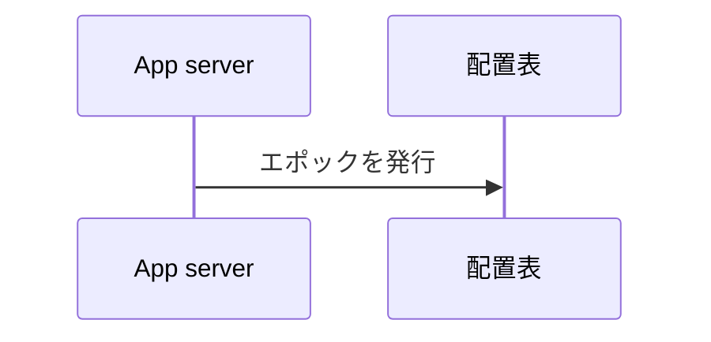

# 表示の確認 (一時ファイル)

## A: summary にコードと太字、空行あり

<details>
<summary>`Start` を再送する案: **一意性**がランチャーに依存する</summary>

本文の **太字** と `コード`。

- 箇条書き

</details>

## B: summary の後に空行なし

<details>
<summary>空行なしの案: 不採用</summary>
本文の **太字** と `コード`。
- 箇条書き
</details>

## C: 折り畳みの中の Mermaid

<details>
<summary>図を含む案: 確認用</summary>



</details>

## D: Mermaid のバージョン

```mermaid
info
```
