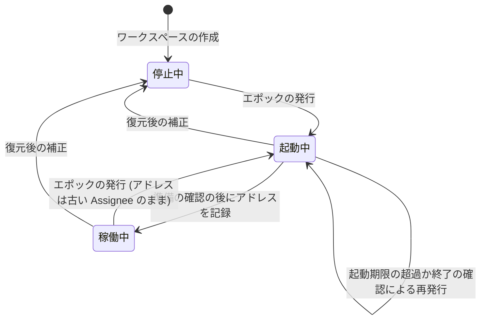
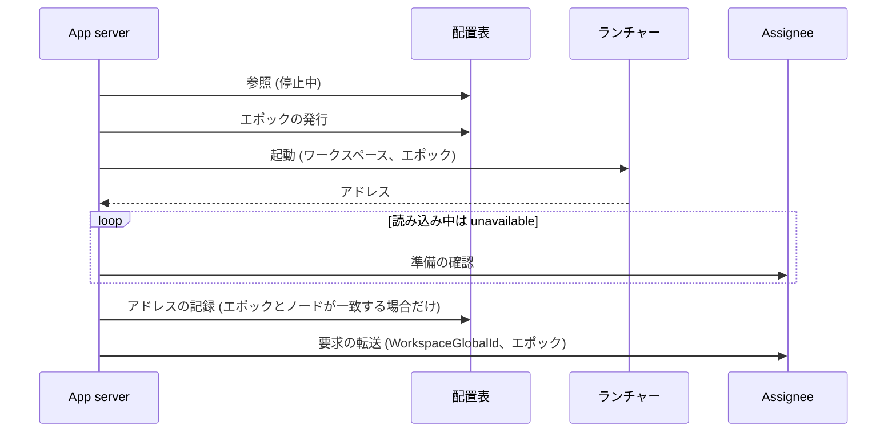
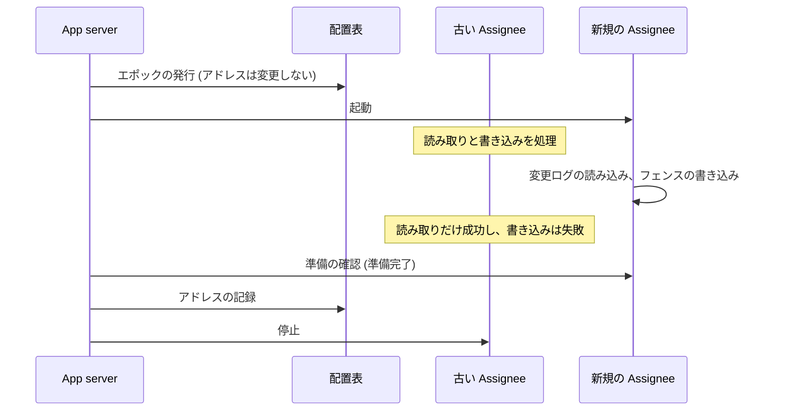

# 配置表の条件付き UPDATE がエポックを発行し、Assignee のプロセスは1個のエポックだけを処理する

- Status: Accepted
- Date: 2026-11-14
- Related: #171 (配置の全体)、#191 (この ADR の PR)、#104 (時計に依存しないエポック)、#111 (読み込み中の区別)、#139 (S3 のキーの ULID)、#81 (連続失敗と backoff)、#184 (本番前に互換を維持しない変更の例)、#194 (形式バージョンの設定)、#197 (App server の転送と交代の実装)、#196 と #240 (ランチャーの独立プロセス化と後続の作業)、#198 (入れ替えと復旧の手順の整備)、#237 (アイドルによる終了とメモリ方針)、#192 (ワークスペースの削除)

ワークスペースごとに1個の Assignee へ要求を転送し、交代のたびに一意で単調増加のエポックを必要とする状況で、エポックの発行の場所、転送先の決定、障害と入れ替えの検出の問題に対し、PostgreSQL の配置表の1行への条件付き UPDATE でエポックを発行し、1個のプロセスが1個のエポックだけを処理し、要求を契機に交代する構成を採用し、Assignee 自身によるエポックの取得、独立した配置コントローラー、heartbeat とリース、配置表の cache を不採用とした。リーダー選出と常駐の調停プロセスを使用せずに、エポックの一意性、単調性、読み取りの鮮度、ワークスペースの分離を達成し、全要求の PostgreSQL への依存と、停止中のワークスペースへの最初の要求の待機を受け入れた。

## Context

[ワークスペース](../../GLOSSARY.md#ワークスペース)ごとに、変更を受理して[変更ログ](../../GLOSSARY.md#変更ログ)に確定するサーバーが [Assignee](../../GLOSSARY.md#変更ログ) である。要求の転送先の Assignee は、1個のワークスペースに1個でなければならない。

変更ログの整合性は、S3 の条件付き書き込みとフェンスが保証する。[ADR 0006](0006-change-log-writes-are-conditional-and-read-back.md) の決定は次のとおりである。1個の Slot には If-None-Match で1回だけ書き込む。新規の Assignee は受理の開始前に次の Slot へフェンスを書き込み、古い Assignee の以後の書き込みを失敗させる。この仕組みは、Assignee ごとに一意で単調増加する[エポック](../../GLOSSARY.md#変更ログ)を前提にする。ADR 0006 は、再起動した Assignee も新規のエポックを取得すると規定したが、エポックの発行の方式は決定しなかった。

この ADR の以前は、Assignee がエポックの既定値を起動時の時刻から生成していた。時計は重複も後退もしうるので、エポックの一意性と単調性は成立しなかった。S3 のキーはワークスペースの名前であった。

解決する問題は次の4点である。

- エポックをどこで一意に、単調増加で発行するか。
- App server が各要求をどの Assignee へ転送するか。ノードはポートを再利用するので、古いアドレスは別のワークスペースの Assignee を指示しうる。
- Assignee の障害、アイドルによる終了、deploy による入れ替えを、どの契機で検出し、どの手順で交代させるか。
- 顧客のオンプレ環境でも、SaaS 環境と同一の構成で稼働させること。

前提として、停止中のワークスペースへの最初の要求は、5〜10秒の待機を許容する。この前提を記録した文書は存在しない。

[配置表](../../GLOSSARY.md#配置表)、配置コントローラー、ランチャー、ノード、読み込み中、準備完了は GLOSSARY.md の定義に従う。以下は GLOSSARY.md に存在しない用語である。

- **App server**: クライアントの要求を受信し、認証と権限の確認の後に Assignee へ転送するサーバー。状態を保持せず、複数台で稼働する。
- **アドレスのエポック**: 配置表に記録したアドレスの Assignee が処理するエポック。
- **起動中**: 配置表の行で、最後に発行したエポックがアドレスのエポックより大きい状態。
- **停止中**: 配置表の行で、アドレスが空で、起動中でない状態。
- **稼働中**: 配置表の行で、アドレスが空でなく、起動中でない状態。
- **準備の確認**: App server が Assignee へ副作用のない操作を送信し、正常な応答を受領すること。正常な応答は準備完了を意味する。
- **稼働中の交代**: 古い Assignee の稼働中に新規の Assignee を起動し、アドレスの記録で転送先を切り替える交代。
- **連続失敗**: 記録から10分以内の交代と、記録に到達しなかった交代。
- **Quint**: 形式仕様の言語。この設計のモデルは [`storage/quint/placement.qnt`](../../storage/quint/placement.qnt) である。

## Decision

App server、配置表、ランチャー、Assignee を以下の構成で接続する。期限、回数、間隔はすべて暫定値で、計測後に確定する。配置表の SQL の正は [`storage/placement/src/lib.rs`](../../storage/placement/src/lib.rs)、表の定義の正は [`0001_placement.sql`](../../storage/placement/migrations/0001_placement.sql) である。

根拠の【検査】は、Quint のモデルで規則を1個ずつ除外し、検証の項に記載する性質に違反することを確認した根拠である。【実測】は、PgBouncer 経由の実 PostgreSQL で、条件を1個ずつ外した mutant が試験に失敗することなどを確認した根拠である。

### 配置表とエポックの発行

- **配置表は PostgreSQL の表で、1個のワークスペースが1行である**。 行は WorkspaceGlobalId、最後に発行したエポック、起動先のノード、発行時刻、アドレス、アドレスのエポック、記録時刻、前回の起動時間、連続失敗回数を保持する。行はワークスペースの作成と同一のトランザクションで作成し、エポックの初期値は 0 である。時刻はすべて PostgreSQL の `now()` で、App server の時計を使用しない。変更ログの整合性は If-None-Match とフェンスが保証するので、配置表に必要な性質はエポックの一意性と単調性だけである。この2性質は PostgreSQL の1行の UPDATE で成立するので、リーダー選出も常駐の調停プロセスも不要になる【検査】。
- **配置コントローラーは独立したプロセスにせず、App server 内の module とする**。 PostgreSQL に接続するのは App server だけである【未検証】。
- **エポックは、主キーで指定した1行への条件付き UPDATE で1増加させる**。 App server は Assignee を起動する直前に発行し、返却された値を使用する。条件は次の4点である。
  - 行のエポックが、直前に読み取った値と一致する。この条件は番号の重複を防止する条件ではない。`SET epoch = epoch + 1` は行の更新の直列化で、条件がなくても異なる番号を発行する。この条件は、同一の観測に基づく発行の成功を高々1回にする。条件がないと、古い観測から不要な交代が連続し、新規の起動を妨げる【検査】。読み取り値に1を加算した値を条件なしで書き込む形式は、並行試験で同一のエポックを8回発行した【実測】。
  - 行のアドレスのエポックが、直前に読み取った値と一致する。参照と発行の間に記録が成立した場合に、起動期限の超過を理由にした発行が記録直後の Assignee を交代させ、失敗に計数する経路を防止する【実測】。
  - 発行時刻から待機時間が経過している。待機時間は、起動中の行では起動期限と backoff の長い方、起動中でない行では backoff である。`now()` はトランザクションの開始時刻で固定され、行ロックの待機後も変化しないので、この条件は期限まで待機せず0行で終了する【実測】。
  - 計画的な入れ替えは、起動中でない行だけを対象にし、待機時間は 0 である。起動中の Assignee をフェンスで停止させないためである【実測】。
- **更新が0行の場合、App server は理由を区別せず配置表を再度参照する**。 0行の理由は、ほかの App server の先行、記録の成立、待機時間の経過前のいずれかで、どれも再度の参照で対処できる【未検証】。
- **発行と記録は autocommit の READ COMMITTED の1文で実行する**。 呼び出し側のトランザクションに含めない。App server は ReadyForQuery まで読み取ってから、発行したエポックを使用する。トランザクション内で発行すると、`now()` が BEGIN の時刻になり、COMMIT の前にエポックを使用する経路と、ROLLBACK による再発行の経路が生じる。RETURNING の行は COMMIT の前にクライアントへ到達するので、ReadyForQuery まで待機する。この推論は主キーで指定した1行への UPDATE を前提にする【未検証】。
- **エポックの発行はアドレスを消去しない**。 新規の Assignee を記録するまで、要求は古い Assignee へ転送する。この規則で、障害時の交代と計画的な入れ替えが同一の遷移になる【検査】。
- **エポックの減少、主キーの変更、行の削除、TRUNCATE は、表の trigger が拒否する**。 trigger は、エポックの減少と、行の再作成による 0 からの再開を手動の SQL に対しても防止する。主キーの変更も、元の WorkspaceGlobalId での再作成を可能にするので拒否する【実測】。
- **新規のワークスペースのエポックは 1 から開始する**。 S3 のキーを WorkspaceGlobalId に変更すると、時刻をエポックにした既存の変更ログは継承されないので、既存の値 (約 1.8e12) より大きい値から開始する必要はない【未検証】。

配置表の行は次の3状態を遷移する。

### Assignee のプロセスとランチャー

- **Assignee のプロセスは、1個のワークスペースの1個のエポックだけを処理する**。 ワークスペースとエポックを必須の引数とし、時刻による既定値を廃止する。Assignee が停止するとプロセスも終了し、同一プロセスでは再開しない。プロセスの寿命とエポックを一致させると、「再起動した Assignee は新規のエポックを取得する」規則 (ADR 0006) をプロセスの構造で保証できる【検査】。Assignee は引数だけで動作が決定するので、手動の起動、`server/demo.sh`、シミュレーションを現状のまま使用できる。Neon の generation numbers も、generation number の有効期間をプロセスの寿命と一致させている【未検証】。
- **Assignee は PostgreSQL に接続しない。S3 に接続するのは Assignee だけである**。 認証情報の配布先が減少し、オンプレ環境でも同一の構成で稼働する【未検証】。
- **Assignee は起動直後に listen を開始し、フェンスの書き込みが完了するまで全操作に `unavailable` を返却する**。 準備の確認の操作も対象である。App server は読み込み中のプロセスと不在のプロセスを区別できる【未検証】。
- **Assignee は、自分の引数と WorkspaceGlobalId またはエポックが一致しない要求を `failed_precondition` で拒否する**。 ノードはポートを再利用するので、配置表のアドレスが古い場合、要求は別のワークスペースの Assignee に到達しうる。WorkspaceGlobalId の照合はこの到達を拒否する【検査】。エポックの照合は、転送中の書き込みに必要である。古い Assignee への書き込みの転送中に、同一のアドレスで後続のエポックの Assignee が起動すると、記録前の Assignee がその書き込みを ACK する【検査】。
- **プロセスの起動と停止は、ノードごとのランチャーが実行する**。 契約は起動、停止、所在の照会の3操作で、引数はワークスペースとエポックである。契約は `proto/` に配置する。起動と所在の照会は listen 中のアドレスを返却する【未検証】。
- **同一のワークスペースとエポックのプロセスが稼働中の場合、ランチャーは起動を拒否する**。 拒否された App server は所在の照会でアドレスを取得する【検査】。
- **ランチャーは PostgreSQL と S3 のどちらにも接続しない**【未検証】。
- **結果が不明な起動は再送しない**。 App server は新規のエポックを発行して起動を再実行し、結果が不明なエポックには停止を1回だけ送信する。停止は失敗しても再送しない。起動の再送を安全にするには、ランチャーが起動済みのエポックを永続的に記録する必要がある。記録を保持しない実装では、再送された起動が同一エポックのプロセスを2個作成する。再送を禁止すると、ランチャーの実装に関係なく一意性が成立する【検査】。エポックは 64 ビットで、消費しても問題にならない【未検証】。

### アドレスの記録と転送

- **アドレスの記録は、準備の確認の後に実行する**。 App server は記録の後に要求を転送し、記録前の Assignee へは書き込みを送信しない。準備の確認で、`unavailable` は読み込み中を意味し、`failed_precondition` と接続の失敗は該当のプロセスの不在を意味する。記録前の新規の Assignee が書き込みを ACK すると、古い Assignee の読み取りはそのコミットを含まない。したがって記録は準備完了の後に限定し、Assignee のアドレスは配置表だけで配布する。クライアントも運用者も Assignee へ直接は接続しない【検査】。
- **記録の UPDATE は、エポックとノードが行と一致する場合だけ成功する**。 ノードの条件は、PostgreSQL の切り替えで同一のエポックが再発行された場合に、記録の対象を行のノードのプロセスに限定する【検査】。同一のエポックの2回目の記録も成功するが、記録時刻と前回の起動時間は最初の値を保持する。記録の応答を喪失して再送した場合に、起動期限と連続失敗の起点を後退させないためである。2回目を0行にすると、呼び出し側が正常な Assignee に停止を送信する【実測】。記録が0行の場合は、起動した Assignee へ停止を送信し、配置表を再度参照する【未検証】。
- **App server は要求ごとに配置表を参照し、内容を cache しない**。 転送先は行のアドレスだけで、WorkspaceGlobalId とアドレスのエポックを付与する。エポックの照合は、cache による古い読み取りを防止しない。交代を認識していない古い Assignee のエポックは、古い cache のエポックと一致するからである【検査】。`failed_precondition` で拒否された場合は、配置表を再度参照して1回だけ再試行する【未検証】。
- **App server は、`unavailable` を受領した要求と失敗した書き込みを10秒まで再試行する**。 再試行は同一の Request ID を使用するので、結果が不明な書き込みを再送しても変更ログには1回だけ記録される。超過した場合はクライアントへ `unavailable` を返却する【未検証】。
- **起動中の行へ到着した要求は、行のアドレスへ転送する**。 アドレスが空の場合と、接続の失敗か `failed_precondition` を受領した場合は、記録まで配置表を polling して待機する。上限は10秒である【未検証】。

停止中のワークスペースへの最初の要求は、次の順序で処理する。アドレスの記録が準備完了の後で、転送が記録の後であることが、この決定の順序の制約である。

### 障害の検出と交代

- **障害は要求を契機に検出し、heartbeat とリースは導入しない**。 停止中のワークスペースへの最初の要求は5〜10秒の待機を許容するので、アイドルによる停止と障害による停止を同一の経路で処理できる。代表モデル (約1億セル) での最初の応答までの時間は、手順ごとの実測と推定の合計で約 2.5〜4.5 秒である【推定】。heartbeat はワークスペース数に比例する書き込みを発生させ、リースは時計の精度を前提にする【未検証】。
- **交代を開始する条件は以下の5個だけで、応答の遅延だけでは交代しない**。 応答の遅延で交代を開始すると、負荷が高い時点で交代が連鎖し、起動の負荷がさらに遅延を拡大する【未検証】。
  1. 行が停止中である。
  2. 行が起動中でなく、Assignee への接続が、短い間隔の数回の試行ですべて失敗した。
  3. 行が起動中でなく、配置表を再度参照した後の要求も `failed_precondition` で拒否された。
  4. 行が起動中のまま、発行時刻から起動期限を超過した。
  5. 行が起動中で、ランチャーが返却したアドレスのプロセスの終了を確認した。準備の確認が `failed_precondition` なら終了と判定する。接続の失敗なら所在を照会し、不在が返却された場合だけ終了と判定する。接続の失敗は、プロセスの不在のほか、ネットワークの分断と accept の待機列の超過でも発生するからである。アドレスを取得していない App server が照会で不在を受領した場合は対象外である。起動の到着前と区別できないからである【未検証】。
- **起動中の行は、どの App server も起動を完了させられる**。 起動中の行を参照した App server は、起動先のノードのランチャーへ所在を照会し、アドレスが返却された場合は準備の確認と記録を代行する【未検証】。
- **起動期限は、前回の起動時間の2倍を基準値にし、連続失敗回数に応じて2倍ずつ延長する**。 基準値の下限は30秒、期限の上限は30分である。前回の起動時間は発行から記録までの時間で、負になる場合は 0 を保存する。起動期限が変更ログの読み込み時間より短いと、次のエポックの Assignee のフェンスが読み込み中の Assignee を停止させ、起動が永久に完了しない。2倍ずつの延長で、期限はいずれ読み込み時間を超過する。前回の起動時間を基準にするので、読み込みが30秒を超過するワークスペースも、2回目以降は通常は期限を超過しない【未検証】。
- **連続失敗を計数し、次回の発行を backoff で遅延させる**。 計数と遅延は発行の UPDATE の内部で実行する。backoff は、回数が 0 なら 0、1 以上なら 1秒 × 2^(回数 − 1) で、上限は5分である。記録から10分以上が経過した交代は回数を 0 に更新し、計画的な入れ替えは回数を変更しない。遅延中の要求には `unavailable` を返却し、連続失敗をログに出力する。連続失敗の判定に終了の理由を使用せず、記録からの時間だけを使用する。App server は終了コードを受領しないからである。この規則は、ストアの恒久的なエラー、メモリ不足、panic、誤認による交代の反復を、クラッシュループとして抑制する【未検証】。
- **アイドルによる終了の期限は、準備完了後の最後の要求を起点にし、10分以上とする**。 正常な終了を連続失敗の計数から除外するためである【未検証】。

要求に識別子を付与して不一致の場合に拒否する方式と、準備が完了しないプロセスを期限で交代させる規則は、以前の試作 (別のリポジトリ nanashi の router) から採用した。

### 入れ替え

- **Assignee、App server、ランチャーの入れ替えは、障害時の交代と同一の規則で実行し、専用の状態を追加しない**。 発行がアドレスを消去しないので、障害時の交代と計画的な入れ替えはモデル上で同一の遷移になる【検査】。
- **Assignee の入れ替えは、新規のエポックの発行、移動先への起動、準備の確認、記録、古い Assignee への停止の順序で実行する**。 記録まで古い Assignee が要求を処理する。書き込みが失敗する期間はフェンスから記録までで、変更ログの読み込みの時間を含まない【検査】。
- **ランチャーの更新は、最初の実装ではノードの交換として実行する**。 ランチャーの再起動は、子プロセスとして起動したそのノードの全 Assignee を停止させるからである【未検証】。
- **App server は1台ずつ入れ替える**。 停止する App server は新規の要求の受信を終了し、処理中の要求の完了を、再試行の期限 (10秒) より長い上限まで待機する【未検証】。

入れ替えとノードの交換の手順は、運用手順として ADR の外で整備する。

### バージョンの混在

本番環境の稼働後は、入れ替えの順序を自由にし、rollback を入れ替えと同一の操作にするため、以下の規則を適用する。本番環境が存在しない期間は対象外で、互換を維持せず形式と契約を変更する (セグメントの形式バージョン 2、payload のバージョン 2、HTTP の座標はこの期間の変更である)。これらの規則の根拠は【未検証】である。

- App server と Assignee の間、App server とランチャーの間の契約は、隣接する2個のバージョンで互換にする。変更はフィールドの追加だけとする。
- 配置表の列の変更は、追加、移行、削除の3回の deploy に分割する。
- Assignee が書き込むセグメントと snapshot の形式バージョンは、起動時の設定で指定する。設定の引き上げは全バイナリの更新の後に実行する。payload は固有のバージョンを保持し、payload の変更はセグメントの形式バージョンを変更しない。
- 形式バージョンごとに、固定のバイト列による読み取りの試験を保持する。変更ログは削除しないので、過去の全形式バージョンの読み取りを継続する必要がある。
- rollback は、古いバージョンを移動先にした入れ替えである。

### 配置表の PostgreSQL の構成

- **確定済みの更新が切り替えで消失しない構成を必須とする**。 非同期のレプリカへの切り替えは、行を以前の状態に復帰させる。稼働中の交代の後に停止が到達せず古い Assignee が残存していると、行はフェンス済みの Assignee を指示し、その Assignee は最初の書き込みで停止するまで、交代後のコミットを含まない読み取りに応答する。読み取りだけのワークスペースでは、この期間に上限がない。この経路はフェンスの識別子では排除できない【検査】。
- **SaaS 環境は、ストレージが複数の AZ (Availability Zone) に同期で複製される形式を使用する。配置表の参照と更新はプライマリ (Aurora では writer endpoint) だけに送信し、読み取り専用のエンドポイントと standby は参照しない**。 `synchronous_commit` の `on` は standby での可視性を保証しないので、standby の参照は記録済みの行より古い行を返却しうる【未検証】。
- **オンプレ環境でレプリカを配置する場合は、以下の3点を必須とする**。 App server はこの要件への違反を検出できない【未検証】。
  - `synchronous_commit` を `on` 以上に設定し、セッションごとの緩和を禁止する。
  - 同期の standby が不在でも、非同期へ自動で降格させない (Patroni では `synchronous_mode_strict`)。
  - 昇格の対象を同期の standby に限定する。
- **行のエポックの減少と、発行済みのエポックを指定したプロセスの再起動を禁止する**。 復元と切り替えの後は、App server を停止し、全行のエポックを補正する UPDATE (`correct_after_restore`) を実行してから再開する。補正の後、全行は停止中になる。どちらの操作も、モデルで変更ログの破損を確認した【検査】。

### その他の構成

- **App server は Rust で実装する**。 契約 (`proto/`) から生成した型を Assignee と共有する。Connect の実装には `connectrpc` crate を使用する。エポックや WorkspaceGlobalId の型を Assignee と1個の言語で保守できる【未検証】。
- **ワークスペースの ID は WorkspaceGlobalId (ULID) とし、App server が作成時に発行する**。 S3 のキーの先頭は WorkspaceGlobalId で、名前は表示専用である【未検証】。ワークスペースの引数が ULID でない場合、Assignee は起動を中止する【実測】。
- **オンプレ環境で必須にする構成は、PostgreSQL、条件付き書き込みに適合する S3 互換ストア、1台以上のノードの3点だけである**。 Kubernetes は必須にしない。Kubernetes を標準の基盤にする顧客には、Pod を作成するランチャーの実装を追加して対応する【未検証】。

### 最初の実装の範囲

最初の実装では、ランチャーを App server 内の interface とローカル実装にし、App server を1台に限定する。App server の再起動で全 Assignee が停止し、新規のエポックで起動する。所在の照会による記録の代行とアイドルによる終了は導入せず、残存したプロセスはランチャーが強制終了で回収する。

### 範囲外

- ノードの選択方法、Assignee がアイドルで終了する条件、同時に起動する個数の上限。ノードのメモリ配置の決定の対象である。最初は1ノードとし、ランチャーのアドレスは App server の設定に記述する。
- App server、Assignee、ランチャーの間の認証。WorkspaceGlobalId とエポックの照合は認証ではない。当面はネットワークの分離を前提にする。
- ワークスペースの削除に伴う行と S3 のデータの削除。
- App server のリポジトリ内の配置場所。
- メトリクスと通知の基盤。連続失敗の通知先は当面ログだけである。

### 検証

モデルが守る不変条件は次の4個である。ADR 0006 の変更ログの性質は、エポックの一意性を前提にする。

- エポックの一意性: 1個のエポックで起動するプロセスは高々1個である (`epochStartsOneProcess`)。
- エポックの単調性: 発行したエポックは減少しない (`epochNeverDecreases`)。
- 読み取りの鮮度: 読み取りの応答は、配置表の参照時点で ACK 済みのコミットをすべて含む (`readSeesAcknowledgedAtLookup`)。
- ワークスペースの分離: 別のワークスペースの Assignee の応答を読み取らない (`neverReadsOtherWorkspace`)。

モデルは連続失敗、backoff、起動期限、所在の照会、停止、ランチャーの再起動、ネットワークの分断を含まない。

- [`storage/quint/placement.qnt`](../../storage/quint/placement.qnt): 設計どおりのモデルと4個の不変条件。
- [`storage/quint/placement_mutations.qnt`](../../storage/quint/placement_mutations.qnt): 規則を1個ずつ除外したモデルと、PostgreSQL の切り替えを含むモデル。
- [`storage/quint/placement_test.qnt`](../../storage/quint/placement_test.qnt): 稼働中の交代の後の読み取りなど、固定の手順。
- [`storage/quint/check.sh`](../../storage/quint/check.sh) と [`storage/quint/README.md`](../../storage/quint/README.md): 除外したモデルごとの違反の確認と、実行の方法。
- [`storage/placement/tests/placement.rs`](../../storage/placement/tests/placement.rs): 発行と記録の各条件と trigger を、PgBouncer 経由の実 PostgreSQL で確認する。
- [`storage/placement/src/mutants.rs`](../../storage/placement/src/mutants.rs): 条件を1個ずつ外した mutant。
- [`server/tests/http.rs`](../../server/tests/http.rs): 読み込み中の `unavailable` と、別のワークスペースかエポックへの要求の `failed_precondition`。
- [`storage/rustfs/conditional_write.py`](../../storage/rustfs/conditional_write.py): S3 互換ストアの条件付き書き込みの適合。
- `server/src/main.rs`、`server/src/http.rs`: この ADR を参照するコメントがある。

## Alternatives Considered

Assignee が変更ログの末尾のエポックに1を加算して使用する: 同時に起動した2個のプロセスが同一のエポックを採用する

同時に起動した2個のプロセスが、同一の末尾を読み取って同一のエポックを採用する。結果は起動を再送する場合と同一である。

Assignee が起動時に自分でエポックを取得する: Assignee が PostgreSQL に依存し、1個のプロセスが複数のエポックを使用しうる

Assignee が PostgreSQL か App server に依存し、1個のプロセスが複数のエポックを使用する経路も発生する。Neon の pageserver はこの方式だが、1個のプロセスが多数のテナントを長期間処理する構成である。

PostgreSQL の sequence 1個で全ワークスペースのエポックを発行する: 発行と配置表の更新が別の操作になる

一意性と単調性は成立するが、発行と配置表の更新が別の操作になる。

配置コントローラーを独立したプロセスにする: 1個なら単一障害点、複数なら結局 PostgreSQL の条件付き更新が必要

1個の場合は要求の経路の単一障害点になる。複数の場合は、結局 PostgreSQL の条件付きの更新が必要になる。

起動を再送し、ランチャーが冪等にする: 一意性がランチャーの実装に依存する

ランチャーが起動済みのエポックを永続的に記録する必要があり、一意性がランチャーの実装に依存する。

heartbeat とリースで障害を検出する: ワークスペース数に比例する書き込みと、時計の精度への依存が発生する

ワークスペース数に比例する書き込みと、時計の精度への依存が発生する。

Assignee 自身が PostgreSQL のリースを取得する: Assignee が PostgreSQL に依存し、S3 のフェンスと役割が重複する

以前の試作 (nanashi の router) の方式で、リースは3秒、強制終了後の復旧に 3.1〜3.3 秒を要した。Assignee が PostgreSQL に依存する。この設計は S3 のフェンスを使用し、リースを保持しない。

起動の記録と backoff を App server のメモリに保持する: App server が1台の構成に限定される

以前の試作の方式で、router が1台の構成に限定された。配置表の行に保持すると、複数の App server で共有できる。

終了コード 0 の停止を連続失敗に計数しない: App server は終了コードを受領しない

以前の試作の方式である。App server は終了コードを受領しないので、アイドルによる終了の期限を計数の時間以上にして区別する。同様に、最後の異常終了の内容を 503 の応答に記載する方式も、ランチャーが PostgreSQL に接続しないので採用せず、運用者はランチャーのログを参照する。

期待する状態を配置表に記録し、ランチャーが polling で一致させる: 起動の待機が延長し、ランチャーに PostgreSQL の認証情報が必要

起動の待機に polling の間隔が加算される。ランチャーに PostgreSQL の認証情報が必要になる。

App server が配置表を cache する: モデルで読み取りの鮮度に違反した

モデルで読み取りの鮮度に違反した。cache を導入する場合は、リースか、要求ごとのエポックの確認が別に必要になる。

App server を Go で実装する: Assignee と言語が分離し、共有の型を2個の言語で保守する

connect-go の実績と、以前の試作の `api/` の資産を利用できる。しかし Assignee と言語が分離し、エポックや WorkspaceGlobalId の型を2個の言語で個別に保守することになる。

Kubernetes や Amazon ECS の API を App server から直接呼び出す: 設計が特定のインフラに固定される

設計が特定のインフラに固定され、オンプレ環境の前提条件が増加する。必要になれば、ランチャーの契約の実装として追加する。

## Consequences

- 古い Assignee は、新規の Assignee の記録まで読み取りに応答する。記録前の新規の Assignee は書き込みを受領しないので、鮮度の性質に違反しない。記録後の古い Assignee からの読み取りは、参照から応答までの間に記録が発生した要求に限定され、記録後のコミットと並行である。ADR 0006 が保留したリースは導入しない。
- 全要求が PostgreSQL に依存し、PostgreSQL の過負荷は全ワークスペースの参照の遅延に波及する。配置表の操作は主キーの単一行に限定し、App server の接続数に上限を設定する。Neon は 2025年5月に、制御プレーンの PostgreSQL の過負荷で起動不能の障害を経験している。
- ノードとの通信だけが断絶した App server は、健全な Assignee の交代を開始する。到達可能なノードがない場合は、起動期限の超過のたびに発行が反復し、backoff が間隔を拡大する。
- 応答するが処理が進行しない Assignee は、起動期限の超過でだけ交代し、稼働後の同種の状態は検出しない。この検出はメトリクスの基盤と同時に決定する。
- 再送しない停止の対象プロセスは残存しうる。残存したプロセスは新規のエポックのフェンスで書き込み不能になり、アイドルの期限で終了する。
- 記録の前に App server が終了すると、準備完了の Assignee が記録されずに残存し、ほかの App server が所在の照会で記録を代行するまで書き込みが失敗する。
- 入れ替えの期間は2個のプロセスがメモリを使用する。ランチャーの再起動とノードの障害の後は、そのノードの全ワークスペースが同時に読み込みを開始する。
- 10億セルの規模のワークスペースは、最初の応答まで 12〜50 秒と推定され、許容範囲を超過する。このワークスペースはアイドルで停止させない。
- PostgreSQL の復元と切り替えでは、発行済みのエポックが行から消失し、同一のエポックが再発行されうる。この場合エポックの一意性と単調性は成立せず、変更ログの破損はフェンスの識別子 (ADR 0006) が防止する。N 個のエポックが消失した行は、最大 N 回の失敗の後に起動する。
- 形式バージョンの設定を引き上げた後は、その形式バージョンを読み取れないバイナリへ rollback できない。
- オンプレ環境の S3 互換ストアは条件付き書き込みの挙動に差異があるので、導入時に `storage/rustfs/conditional_write.py` で適合を確認する。

未解決:

- ノードの選択方法、アイドルによる終了の条件、同時起動の上限は、ノードのメモリ配置の決定と同時に決定する (Related のアイドルによる終了の issue)。
- コンポーネント間の認証と mTLS (mutual TLS) の要否は、オンプレ環境の顧客の要件が確定した時点で決定する。対応する issue は存在しない。
- 形式バージョンを起動時の設定で指定する仕組みは未実装である (Related の形式バージョンの issue)。
- 入れ替え、ノードの交換、復元後の補正の手順は、実行可能な形式で存在しない (Related の手順の issue)。
- 停止中のワークスペースの最初の応答までの時間は推定の合計で、全手順を連結した実測は存在しない。
- Amazon S3 と RustFS 以外のストア (MinIO、Ceph) の条件付き書き込みの挙動は未確認である。
- Anaplan、Pigment、Workday Adaptive Planning のプロセスの配置は、公開情報が存在しなかった。

見直す条件:

- 期限、回数、間隔の暫定値は、計測の結果が得られた時点で確定する。
- 障害の直後の待機を許容できない専用ノードと待機系を導入する時点で、heartbeat とリースを再検討する。ノードとの通信だけが断絶した App server による交代も、この時点で再検討する。
- 主キー以外の条件 (JOIN、subquery、別の表) を発行や記録の UPDATE に追加する場合は、競合した UPDATE の再評価の挙動が異なるので、トランザクションと `now()` の推論を再検討する。
- snapshot とセグメントの削除を導入する時点で、削除の直前に配置表のエポックを確認する規則を追加する。現在はどちらも削除しない ([ADR 0010](0010-snapshot-is-a-cache-of-the-start-of-the-log.md): snapshot は変更ログの先頭の cache で、正は変更ログである)。
- 複数ノード化か、App server の更新で Assignee を停止できなくなった時点で、ランチャーを独立したプロセスへ分離し、最初の実装の範囲を解除する。
- `connectrpc` crate (バージョン 0.x、App server の試作は存在しない) の不適合が判明した場合は、通信の契約、ライブラリ、実装言語の順に代替を評価する。
