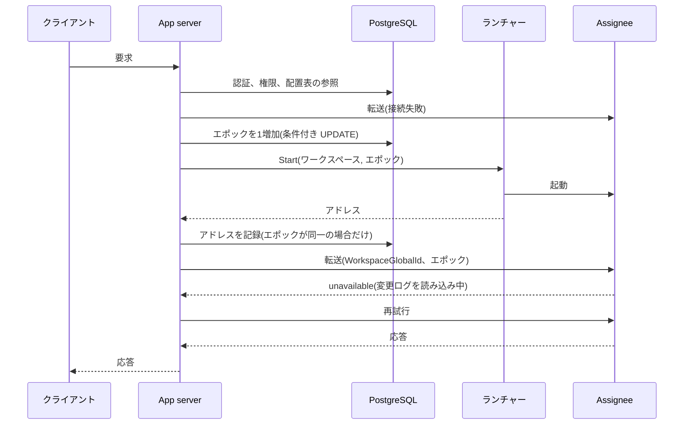

# 配置表がエポックを発行し、Assignee のプロセスは1個のエポックだけを担当する

2026-11-14

## 決定事項

App server、配置表、Assignee を以下の構成で接続する。数値はすべて暫定値で、計測後に確定する。

- **配置表は PostgreSQL の表で、1個のワークスペースが1行である**。 行は WorkspaceGlobalId、最後に発行したエポック、ノード、Assignee のアドレス、更新時刻、連続失敗回数を保持する。アドレスが空の行は「起動中」を意味する。
- **配置コントローラーは独立したプロセスにせず、App server 内の module とする**。 配置表の更新は、エポックが読み取り時と同一の場合だけ成功する条件付きの UPDATE で実行する。複数の App server が同時に更新しても、成功するのは1個である。
- **エポックは配置表の行で発行する**。 App server は Assignee を起動する直前に行のエポックを1増加させ、その値を使用する。新規のワークスペースのエポックは 1 から開始する(#104)。
- **Assignee のプロセスは、1個のワークスペースの1個のエポックだけを担当する**。 `--workspace` と `--epoch` を必須の引数とし、時刻による既定値を廃止する。Assignee が停止するとプロセスも終了し、同一プロセスでは再開しない。Assignee は PostgreSQL に接続しない。
- **プロセスの起動と停止は、ノードごとのランチャーが実行する**。 ランチャーの契約は `Start(ワークスペース, エポック)` と `Stop(ワークスペース, エポック)` の2操作で、`proto/` に配置する。`Start` は listen 中のアドレスを返却する。最初の実装は子プロセスの起動である。ランチャーは PostgreSQL と S3 のどちらにも接続しない。
- **結果が不明な `Start` は再送しない**。 応答がない場合、App server は新規のエポックを発行して起動を再実行する。アドレスが空の状態で期限(30秒)を超過した行も同様に処理する。
- **App server は要求ごとに配置表を参照し、WorkspaceGlobalId とエポックを付与して Assignee へ転送する**。 Assignee は自分の引数と一致しない要求を拒否する。配置表の内容は cache しない。
- **障害は要求を契機に検出する**。 Assignee への接続が失敗すると、App server は新規のエポックを発行して起動を再実行する。heartbeat とリースは導入しない。
- **Assignee は起動直後に listen を開始し、変更ログの末尾に到達するまで全操作に `unavailable` を返却する(#111)**。 App server は `unavailable` を期限(10秒)まで再試行し、超過した場合はクライアントへ `unavailable` を返却する。
- **起動から10分以内の停止を連続失敗として計数し、次回の起動を backoff で遅延させる(#81)**。 遅延中の要求には `unavailable` を返却し、連続失敗をログに出力する。
- **ワークスペースの ID は `WorkspaceGlobalId`(ULID)とし、App server がワークスペースの作成時に発行する(#139)**。 S3 のキーの先頭は WorkspaceGlobalId で、名前は表示専用とする。`--workspace` が ULID でない場合、Assignee は起動を中止する。

配置表の中心になる更新は以下の1文である。`$seen` は直前に読み取ったエポックで、更新が0行の場合はほかの App server が先行している。

```sql
UPDATE placement
SET epoch = epoch + 1, node = $node, address = NULL, updated_at = now()
WHERE workspace_global_id = $workspace AND epoch = $seen
RETURNING epoch;
```

停止中のワークスペースへの最初の要求は、以下の順序で処理する。



## 用語

以下の用語は、この ADR の採用時に `GLOSSARY.md` へ追加する。

- **配置表**: ワークスペースごとに、最後に発行したエポックと Assignee の所在を記録する PostgreSQL の表。
- **配置コントローラー**: 配置表を更新し、エポックを発行する App server 内の module。
- **ランチャー**: ノードで Assignee のプロセスを起動、停止するプロセス。
- **ノード**: Assignee のプロセスが稼働する計算機。仮想マシンかコンテナかは限定しない。

## 理由

- 変更ログの整合性は、If-None-Match とフェンスが保証する(ADR 0006)。配置表に必要な性質は「同一ワークスペースのエポックが重複せず、増加する」ことだけである。この性質は PostgreSQL の1行の UPDATE で成立するので、リーダー選出も常駐の調停プロセスも不要になる。
- 配置表が誤って2個の Assignee を同時に稼働させても、変更ログは破損しない。影響は読み取りの鮮度に限定される。
- プロセスの寿命とエポックを一致させると、「再起動した Assignee は新規のエポックを取得する」規則(ADR 0006)を、プロセスの構造で保証できる。Assignee は引数だけで動作が決定するので、手動の起動、`demo.sh`、シミュレーションは現状のまま使用可能である。
- ランチャーが再起動して起動済みのプロセスの記録を喪失すると、再送された `Start` は同一エポックのプロセスを2個作成する。エポックは 64 ビットで、消費しても問題にならない。
- ノードはポートを再利用する。配置表のアドレスが古い場合、要求は別のワークスペースの Assignee に到達しうる。WorkspaceGlobalId とエポックの照合が、ほかのテナントのデータの返却を防止する。
- 停止中のワークスペースへの最初の操作は5〜10秒の待機を許容する、と決定済みである。この前提では、アイドルによる停止と障害による停止を同一の経路で処理できる。heartbeat はワークスペース数に比例する書き込みを発生させ、リースは時計の精度を前提にする。
- Assignee が起動直後に listen すると、接続の失敗は「プロセスが存在しない」ことだけを意味する。読み込み中の応答を `unavailable` に統一すると、クライアントは「変更ログが空」と「読み込み中」を区別できる。
- 連続失敗の判定に終了の理由を使用せず、起動からの時間だけを使用する。この規則は、ストアの恒久的なエラーに加えて、メモリ不足と panic の反復も抑制する。終了の理由を App server へ伝達する経路も不要になる。
- S3 のキーを WorkspaceGlobalId に変更すると、時刻をエポックにした既存の変更ログは継承されない。したがって、エポックを既存の値(約 1.8e12)より大きい値から開始する必要はない。
- PostgreSQL に接続するのは App server だけ、S3 に接続するのは Assignee だけになる。認証情報の配布先が減少し、顧客のオンプレ環境でも同一の構成で稼働する。

## 不採用の案

- **Assignee が変更ログの末尾のエポックに1を加算して使用する**: 同時に起動した2個のプロセスが同一のエポックを採用する。フェンスは内容が空なので、双方が「自分の書き込みが成功した」と判定する。
- **Assignee が起動時に自分でエポックを取得する**: Assignee が PostgreSQL か App server に依存する。1個のプロセスが複数のエポックを使用する経路も発生する。
- **配置コントローラーを独立したプロセスにする**: 1個の場合は要求の経路の単一障害点になる。複数の場合は、結局 PostgreSQL の条件付きの更新が必要になる。
- **heartbeat とリースで障害を検出する**: 理由は上記のとおり。障害の直後の待機を許容できない専用ノードと待機系を導入する時点で再検討する。
- **期待する状態を配置表に記録し、ランチャーが polling で一致させる**: 起動の待機に polling の間隔が加算される。ランチャーに PostgreSQL の認証情報が必要になる。
- **Kubernetes や Amazon ECS の API を App server から直接呼び出す**: 設計が特定のインフラに固定され、オンプレ環境の前提条件が増加する。必要になれば、ランチャーの契約の実装として追加する。
- **App server が配置表を cache する**: 古い cache を保持する App server が、交代済みの古い Assignee から値を読み取る。PostgreSQL の参照が計測で問題になった時点で、期限付きの cache を検討する。
- **PostgreSQL の sequence 1個で全ワークスペースのエポックを発行する**: 性質は成立するが、発行と配置表の更新が別の操作になる。

## 影響

- 古い Assignee からの読み取りは、配置表の参照から応答までの間に交代が発生した要求に限定される。`at_least` を指定した読み取りは、古い Assignee では条件が成立せず `unavailable` になる。ADR 0006 が保留したリースは、現時点では導入しない。
- 一時的な通信障害を停止と誤認すると、不要な交代が発生する。App server は接続を短い間隔で数回試行してから交代を開始する。交代後は古いエポックへ `Stop` を送信するが、失敗しても再送しない。残存した古いプロセスはアイドルの期限で終了する。
- 起動中に到着した要求は、配置表を polling して待機する。
- ノードの選択方法は、この ADR では決定しない。最初は1ノードとし、ランチャーのアドレスは App server の設定に記述する。保持セル数による配置は、相乗りのメモリ配置の ADR と同時に決定する。
- Assignee がアイドルで終了する条件も、相乗りのメモリ配置の ADR で決定する。
- `demo.sh` と `server/README.md` は、`--epoch` を明示する形式に変更する。
- 連続失敗の通知先はログだけである。メトリクスと通知の基盤は別に決定する。
- App server の実装言語と配置場所は、この ADR では決定しない。
- 上記の SQL は未実行である。PgBouncer の transaction mode で動作する想定だが、実装時に確認する。
