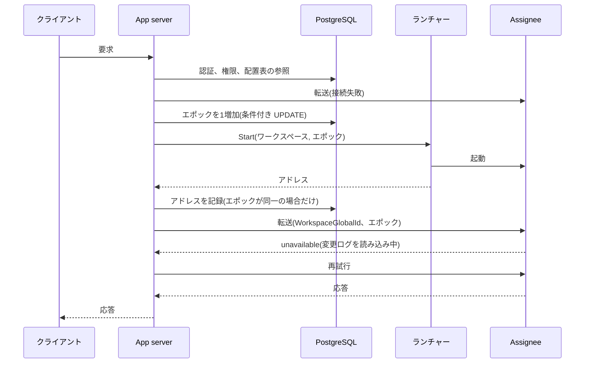

# 配置表がエポックを発行し、Assignee のプロセスは1個のエポックだけを担当する

2026-11-14

## 決定事項

App server、配置表、Assignee を以下の構成で接続する。期限と回数はすべて暫定値で、計測後に確定する。

各項目の末尾の記号は根拠の種類である。【検査】は Quint のモデル(`storage/quint/placement.qnt`)で、規則の除外による違反を確認した項目である。【実測】は実行結果がある項目、【推定】は実測値からの計算、【未検証】は推論だけの項目である。

- **配置表は PostgreSQL の表で、1個のワークスペースが1行である**。 行は WorkspaceGlobalId、最後に発行したエポック、ノード、Assignee のアドレス、更新時刻、連続失敗回数を保持する。アドレスが空の行は「起動中」を意味する。【未検証】
- **配置コントローラーは独立したプロセスにせず、App server 内の module とする**。【未検証】
- **エポックは、読み取り時の値と一致する場合だけ成功する UPDATE で発行する(#104)**。 App server は Assignee を起動する直前に行のエポックを1増加させ、その値を使用する。新規のワークスペースのエポックは 1 から開始する。【検査】【実測】
- **Assignee のプロセスは、1個のワークスペースの1個のエポックだけを担当する**。 `--workspace` と `--epoch` を必須の引数とし、時刻による既定値を廃止する。Assignee が停止するとプロセスも終了し、同一プロセスでは再開しない。Assignee は PostgreSQL に接続しない。【検査】
- **プロセスの起動と停止は、ノードごとのランチャーが実行する**。 ランチャーの契約は `Start(ワークスペース, エポック)` と `Stop(ワークスペース, エポック)` の2操作で、`proto/` に配置する。`Start` は listen 中のアドレスを返却する。最初の実装は子プロセスの起動である。ランチャーは PostgreSQL と S3 のどちらにも接続しない。【未検証】
- **結果が不明な `Start` は再送しない**。 応答がない場合、App server は新規のエポックを発行して起動を再実行する。【検査】
- **App server は要求ごとに配置表を参照し、WorkspaceGlobalId とエポックを付与して Assignee へ転送する**。 Assignee は自分の引数と一致しない要求を拒否する。配置表の内容は cache しない。【検査】
- **Assignee は起動直後に listen を開始し、フェンスの書き込みが完了するまで全操作に `unavailable` を返却する(#111)**。 App server は `unavailable` を期限(10秒)まで再試行し、超過した場合はクライアントへ `unavailable` を返却する。【検査】
- **障害は要求を契機に検出し、heartbeat とリースは導入しない**。 交代を開始する条件は以下の2個だけである。応答の遅延だけでは交代しない。【未検証】
  - Assignee への接続が、短い間隔の数回の試行ですべて失敗した。
  - 行が起動中のまま、または Assignee が `unavailable` のまま、ワークスペースごとの起動期限を超過した。
- **起動から10分以内の交代を連続失敗として計数し、次回の起動を backoff で遅延させる(#81)**。 遅延中の要求には `unavailable` を返却し、連続失敗をログに出力する。【未検証】
- **計画的な移動では、古い Assignee の終了を確認してから新規のエポックを発行する**。 フェンスによる停止は、障害時の手段とする。【未検証】
- **ワークスペースの ID は `WorkspaceGlobalId`(ULID)とし、App server がワークスペースの作成時に発行する(#139)**。 S3 のキーの先頭は WorkspaceGlobalId で、名前は表示専用とする。`--workspace` が ULID でない場合、Assignee は起動を中止する。【未検証】

配置表の中心になる更新は以下の1文である。`$seen` は直前に読み取ったエポックで、更新が0行の場合はほかの App server が先行している。

```sql
UPDATE placement
SET epoch = epoch + 1, node = $node, address = NULL, updated_at = now()
WHERE workspace_global_id = $workspace AND epoch = $seen
RETURNING epoch;
```

停止中のワークスペースへの最初の要求は、以下の順序で処理する。



## 不変条件

配置の手順が保証する性質は以下の4個である。変更ログの性質(ADR 0006)は、1番目の性質を前提にして成立する。

| 性質 | Quint の名前 | 意味 |
| --- | --- | --- |
| エポックの一意性 | `epochStartsOneProcess` | 1個のエポックで起動するプロセスは高々1個である |
| エポックの単調性 | `epochNeverDecreases` | 配置表のエポックは減少しない |
| 読み取りの鮮度 | `readSeesAcknowledgedAtLookup` | 読み取りの応答は、App server が配置表を参照した時点で ACK 済みのコミットをすべて含む |
| ワークスペースの分離 | `neverReadsOtherWorkspace` | 要求は、ほかのワークスペースの Assignee から応答を受領しない |

## 用語

以下の用語は、この ADR の採用時に `GLOSSARY.md` へ追加する。

- **配置表**: ワークスペースごとに、最後に発行したエポックと Assignee の所在を記録する PostgreSQL の表。
- **配置コントローラー**: 配置表を更新し、エポックを発行する App server 内の module。
- **ランチャー**: ノードで Assignee のプロセスを起動、停止するプロセス。
- **ノード**: Assignee のプロセスが稼働する計算機。仮想マシンかコンテナかは限定しない。

## 検証の結果

### モデルの検査

`storage/quint/placement.qnt` は、変更ログのモデル(`seqlog.qnt`)を拡張したモデルである。追加した要素は、配置表、2個の App server、ランチャー、読み取りである。App server は任意の時点で交代を開始でき、`Start` は消失しうる。アドレスはほかのワークスペースが再利用しうる。

設計どおりのモデルは、5万回のランダムシミュレーションで、上記の4個の性質と変更ログの6個の性質に違反しなかった。網羅検査ではない。規則を個別に除外した結果は以下のとおりである。

| 除外した規則 | 違反した性質 | 確認の方法 |
| --- | --- | --- |
| UPDATE の条件(`epoch = $seen`) | エポックの一意性、エポックの単調性 | ランダムシミュレーション |
| `Start` を再送しない | エポックの一意性。ACK 済みのコミットが変更ログに存在しない(`refinesChangeLog`) | ランダムシミュレーションと固定の手順 |
| WorkspaceGlobalId とエポックの照合 | ワークスペースの分離 | ランダムシミュレーション |
| フェンスの完了前は `unavailable` | 読み取りの鮮度 | 固定の手順 |
| 配置表を cache しない | 読み取りの鮮度 | 固定の手順 |

この結果から、以下の2点が判明した。

- 異なるエポックの Assignee が同時に稼働しても、変更ログは破損しない。同一エポックのプロセスが2個存在すると破損する。双方が相手の書き込みを「自分の書き込み」と判定するからである。したがって、UPDATE の条件と `Start` の再送の禁止は、変更ログの整合性の前提である。
- エポックの照合は、cache による古い読み取りを防止しない。交代を認識していない古い Assignee のエポックは、古い cache のエポックと一致するからである。cache を導入する場合は、リースか、要求ごとのエポックの確認が別に必要になる。

### PostgreSQL の並行試験

`storage/postgres/epoch_race.py` は、8個の接続が同時にエポックを取得する試験を50回反復する。接続は PgBouncer 1.25.2 の transaction mode を経由し、prepared statement を使用しない。PostgreSQL は 18 である。

| UPDATE の形式 | 発行されたエポック | 同一エポックの最大発行回数 |
| --- | --- | --- |
| 条件付き(`WHERE epoch = $seen`) | 1〜50 の各値 | 1回 |
| 条件なし(`SET epoch = $seen + 1`) | 1〜50 の各値 | 8回 |

### 最初の応答までの時間

停止中のワークスペースへの最初の要求が応答を受領するまでの時間を、手順ごとに分解する。規模は代表モデル(約1億セル、入力セル 2,010万)である。

| 手順 | 時間 | 根拠 |
| --- | --- | --- |
| 配置表の参照 | p50 0.18 ms、p99 0.51 ms | 【実測】同一ホストの PgBouncer 経由、2,000回。ネットワークの遅延を含まない |
| エポックの発行とアドレスの記録 | 各 1 ms 前後 | 【推定】参照と同等の単一行の操作 |
| プロセスの起動から listen まで | 14〜16 ms | 【実測】クラウド環境 4コア、5回、最小のワークスペース |
| 最小のワークスペースで起動から最初の ACK まで | 25〜28 ms | 【実測】同上。S3 は同一ホストの RustFS |
| snapshot の LIST | p99 36 ms | 【実測】東京の S3 |
| snapshot の取得(69 MB) | 約 0.14 秒 | 【推定】東京の S3 の実測の帯域 490〜510 MB/s から計算 |
| snapshot の展開 | 0.26 秒 | 【実測】クラウド環境、1スレッド |
| 全体再計算 | 約 1.7 秒 | 【推定】1スレッドで毎秒約 2,000万セル、4スレッドで 2.93 倍の実測から計算 |
| snapshot 以降のセグメントの取得(最大 256 個) | 約 0.4 秒 | 【推定】1回の GET を 20 ms と仮定した試験の結果から計算 |
| セグメントの反映 | 最大で全体再計算と同等 | 【推定】 |
| フェンスの PUT | p99 85 ms | 【実測】東京の S3 |

合計は約 2.5〜4.5 秒で、許容される待機時間(5〜10秒)に収容可能である。この合計は推定で、全手順を連結した実測は存在しない。10億セルの規模では 12〜50 秒と推定しており、許容範囲を超過する。この規模のワークスペースは、アイドルで停止させない運用が必要になる。

## 運用者の復旧手順

起動不能のワークスペースは、以下の順序で復旧させる。

1. 配置表の行を参照し、エポック、アドレス、連続失敗回数を確認する。
2. 該当するノードのランチャーのログで、該当するエポックのプロセスの終了コードと標準エラー出力を確認する。
3. 原因(S3 の権限、メモリの上限、不正なコミット)を修正する。
4. 行の連続失敗回数を 0 に更新する。次回の要求で、App server が新規のエポックを発行して起動する。
5. 稼働中の Assignee を強制的に交代させる場合は、行のエポックを1増加させ、アドレスを空にする。任意の時点の交代は、モデルの検査の対象である。
6. App server とランチャーの双方が使用不能の場合は、手順5の UPDATE が返却したエポックを `--epoch` に指定し、Assignee を手動で起動する。

以下の2操作は禁止する。どちらも、モデルで変更ログの破損を確認した操作である。

- 行のエポックを減少させる。
- 発行済みのエポックを指定して、プロセスを再度起動する。

## 理由

- 変更ログの整合性は、If-None-Match とフェンスが保証する(ADR 0006)。配置表に必要な性質はエポックの一意性と単調性だけである。これらの性質は PostgreSQL の1行の UPDATE で成立するので、リーダー選出も常駐の調停プロセスも不要になる。
- プロセスの寿命とエポックを一致させると、「再起動した Assignee は新規のエポックを取得する」規則(ADR 0006)を、プロセスの構造で保証できる。Assignee は引数だけで動作が決定するので、手動の起動、`demo.sh`、シミュレーションは現状のまま使用可能である。Neon の generation numbers も、世代番号の有効期間をプロセスの寿命と一致させている。
- ランチャーが再起動して起動済みのプロセスの記録を喪失すると、再送された `Start` は同一エポックのプロセスを2個作成する。エポックは 64 ビットで、消費しても問題にならない。
- ノードはポートを再利用する。配置表のアドレスが古い場合、要求は別のワークスペースの Assignee に到達しうる。
- 停止中のワークスペースへの最初の要求は5〜10秒の待機を許容する、と決定済みである。この前提では、アイドルによる停止と障害による停止を同一の経路で処理できる。heartbeat はワークスペース数に比例する書き込みを発生させ、リースは時計の精度を前提にする。
- Assignee が起動直後に listen すると、接続の失敗は「プロセスが存在しない」ことだけを意味する。
- 応答の遅延で交代を開始すると、負荷が高い時点で交代が連鎖し、起動の負荷がさらに遅延を拡大する。
- 連続失敗の判定に終了の理由を使用せず、起動からの時間だけを使用する。この規則は、ストアの恒久的なエラーに加えて、メモリ不足と panic の反復も抑制する。誤認による交代の反復も同一の規則で抑制する。
- S3 のキーを WorkspaceGlobalId に変更すると、時刻をエポックにした既存の変更ログは継承されない。したがって、エポックを既存の値(約 1.8e12)より大きい値から開始する必要はない。
- PostgreSQL に接続するのは App server だけ、S3 に接続するのは Assignee だけになる。認証情報の配布先が減少し、顧客のオンプレ環境でも同一の構成で稼働する。

## 以前の試作との差異

nanashi の `router/` は同種の仕組みを実装済みである。採用した点、変更した点、未採用の点は以下のとおりである。

- **採用**: 要求にモデルの ID を付与し、不一致の場合にエンジンが拒否する方式。終了コード 0 の停止を失敗に計数しない規則。起動後に準備が完了しないプロセスを期限で交代させる規則。
- **変更**: nanashi はエンジンが PostgreSQL のリース(3秒)を自分で取得し、強制終了後の復旧に 3.1〜3.3 秒を要した。この設計は S3 のフェンスを使用し、リースを保持しない。
- **変更**: nanashi は起動の記録と backoff を router のメモリに保持したので、router が1台の構成に限定された。この設計は配置表の行に保持し、複数の App server で共有する。
- **未採用**: nanashi は最後の異常終了の内容を 503 の応答に記載した。この設計では、ランチャーが PostgreSQL に接続しないので、運用者はランチャーのログを参照する。

## 不採用の案

- **Assignee が変更ログの末尾のエポックに1を加算して使用する**: 同時に起動した2個のプロセスが同一のエポックを採用する。結果は「`Start` を再送しない」規則の除外と同一である。
- **Assignee が起動時に自分でエポックを取得する**: Assignee が PostgreSQL か App server に依存する。1個のプロセスが複数のエポックを使用する経路も発生する。Neon の pageserver はこの方式だが、1個のプロセスが多数のテナントを長期間担当する構成である。
- **配置コントローラーを独立したプロセスにする**: 1個の場合は要求の経路の単一障害点になる。複数の場合は、結局 PostgreSQL の条件付きの更新が必要になる。
- **heartbeat とリースで障害を検出する**: 理由は上記のとおりである。障害の直後の待機を許容できない専用ノードと待機系を導入する時点で再検討する。
- **期待する状態を配置表に記録し、ランチャーが polling で一致させる**: 起動の待機に polling の間隔が加算される。ランチャーに PostgreSQL の認証情報が必要になる。
- **Kubernetes や Amazon ECS の API を App server から直接呼び出す**: 設計が特定のインフラに固定され、オンプレ環境の前提条件が増加する。必要になれば、ランチャーの契約の実装として追加する。
- **App server が配置表を cache する**: モデルの検査のとおり、読み取りの鮮度に違反する。
- **PostgreSQL の sequence 1個で全ワークスペースのエポックを発行する**: 性質は成立するが、発行と配置表の更新が別の操作になる。

## 影響

- 古い Assignee からの読み取りは、配置表の参照から応答までの間に交代が発生した要求に限定される。この読み取りは交代後のコミットと並行なので、そのコミットを含まなくても鮮度の性質に違反しない。ADR 0006 が保留したリースは、現時点では導入しない。
- 全要求が PostgreSQL に依存する。PostgreSQL が過負荷になると、参照の遅延が全ワークスペースに波及する。配置表の操作は主キーの単一行に限定し、App server の接続数に上限を設定する。Neon は 2025年5月に、制御プレーンの PostgreSQL の過負荷で起動不能の障害を経験している。
- 応答するが処理が進行しない Assignee は、起動期限の超過でだけ交代する。稼働後に同種の状態になった場合は検出しない。この検出はメトリクスの基盤と同時に決定する。
- 交代後は古いエポックへ `Stop` を送信するが、失敗しても再送しない。残存した古いプロセスはアイドルの期限で終了する。
- 起動中に到着した要求は、配置表を polling して待機する。
- snapshot とセグメントの削除を導入する時点で、削除の直前に配置表のエポックを確認する規則が必要になる。現在はどちらも削除しない(ADR 0010)。
- オンプレ環境の S3 互換ストアは、条件付き書き込みの挙動に差異がある。導入時に `storage/rustfs/conditional_write.py` を実行し、適合を確認する。
- ノードの選択方法は、この ADR では決定しない。最初は1ノードとし、ランチャーのアドレスは App server の設定に記述する。保持セル数による配置は、ノードのメモリ配置の ADR(番号 0007 を予約済み) と同時に決定する。
- Assignee がアイドルで終了する条件も、同じ ADR で決定する。
- `demo.sh` と `server/README.md` は、`--epoch` を明示する形式に変更する。
- 連続失敗の通知先はログだけである。メトリクスと通知の基盤は別に決定する。
- App server の実装言語と配置場所は、この ADR では決定しない。

## 未読の資料

- Amazon S3 以外のストア(MinIO、Ceph)の条件付き書き込みの挙動は、RustFS を除いて未確認である。
- Anaplan、Pigment、Workday Adaptive Planning のプロセスの配置は、公開情報が存在しなかった。
