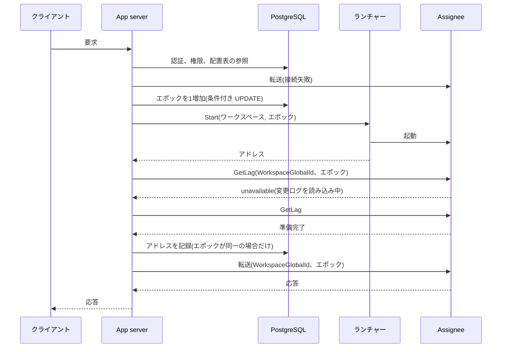
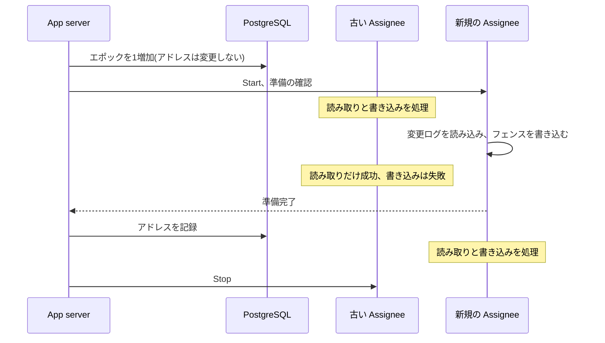

# 配置表がエポックを発行し、Assignee のプロセスは1個のエポックだけを処理する

2026-11-14

## 決定事項

App server、配置表、Assignee を以下の構成で接続する。期限と回数はすべて暫定値で、計測後に確定する。

各項目の末尾の記号は根拠の種類である。項目の途中の記号は、その直前の文までの根拠である。【検査】は Quint のモデル(`storage/quint/placement.qnt`)で、規則の除外による違反を確認した項目である。【実測】は実行結果がある項目、【推定】は実測値からの計算、【未検証】は推論だけの項目である。

- **配置表は PostgreSQL の表で、1個のワークスペースが1行である**。 行は WorkspaceGlobalId、最後に発行したエポック、起動先のノード、発行時刻を保持する。加えて、Assignee のアドレス、アドレスのエポック、記録時刻、前回の起動時間、連続失敗回数を保持する。アドレスのエポックは、そのアドレスの Assignee が処理するエポックである。最後に発行したエポックがアドレスのエポックより大きい行は「起動中」を意味する。行は、ワークスペースの作成と同一のトランザクションで作成する。初期値は、エポックとアドレスのエポックと連続失敗回数が 0、アドレスと時刻が空である。アドレスが空で起動中でない行は「停止中」を意味する。時刻はすべて PostgreSQL の `now()` で、App server の時計を使用しない。【未検証】
- **App server は Rust で実装する**。 Assignee と同一の言語で、契約(`proto/`)から生成した型を双方で共有する。Connect の実装は `connectrpc` crate を使用する。【未検証】
- **配置コントローラーは独立したプロセスにせず、App server 内の module とする**。 【未検証】
- **エポックは、読み取り時の値と一致する場合だけ成功する UPDATE で発行する(#104)**。 App server は Assignee を起動する直前に行のエポックを1増加させ、その値を使用する。新規のワークスペースのエポックは 1 から開始する。【検査】【実測】
- **Assignee のプロセスは、1個のワークスペースの1個のエポックだけを処理する**。 `--workspace` と `--epoch` を必須の引数とし、時刻による既定値を廃止する。Assignee が停止するとプロセスも終了し、同一プロセスでは再開しない。Assignee は PostgreSQL に接続しない。【検査】
- **プロセスの起動と停止は、ノードごとのランチャーが実行する**。 ランチャーの契約は `Start(ワークスペース, エポック)`、`Stop(ワークスペース, エポック)`、`Find(ワークスペース, エポック)` の3操作で、`proto/` に配置する。`Start` と `Find` は listen 中のアドレスを返却する。最初の実装は子プロセスの起動である。ランチャーは PostgreSQL と S3 のどちらにも接続しない。【未検証】
- **結果が不明な `Start` は再送しない**。 応答がない場合、App server は新規のエポックを発行して起動を再実行する。【検査】結果が不明なエポックには `Stop` を1回送信する。【未検証】
- **アドレスの記録は、準備の確認の後に実行する**。 記録の対象は、準備が完了した Assignee だけである。App server は記録の後に要求を転送し、記録前の Assignee へは書き込みを送信しない。【検査】準備の確認は副作用のない `GetLag` で、WorkspaceGlobalId とエポックを付与して送信する。Assignee が正常に応答した時点で完了する。`unavailable` は読み込み中を意味し、`failed_precondition` と接続の失敗は、そのアドレスに該当のプロセスが存在しないことを意味する。記録の UPDATE が0行の場合は、起動した Assignee へ `Stop` を送信し、配置表を再度参照する。【未検証】
- **App server は要求ごとに配置表を参照し、WorkspaceGlobalId とエポックを付与して Assignee へ転送する**。 転送先は行のアドレスだけで、付与するエポックはアドレスのエポックである。Assignee は自分の引数と一致しない要求を拒否する。配置表の内容は cache しない。【検査】拒否の応答は `failed_precondition` である。拒否された App server は、配置表を再度参照して1回だけ再試行する。【未検証】
- **Assignee は起動直後に listen を開始し、フェンスの書き込みが完了するまで全操作に `unavailable` を返却する(#111)**。 `GetLag` も対象で、この応答が準備の確認の信号になる。App server は `unavailable` と書き込みの失敗を期限(10秒)まで再試行し、超過した場合はクライアントへ `unavailable` を返却する。再試行は同一の Request ID を使用するので、結果が不明な書き込みを再送しても、変更ログには1回だけ記録される。【未検証】
- **障害は要求を契機に検出し、heartbeat とリースは導入しない**。 交代を開始する条件は以下の4個だけである。応答の遅延だけでは交代しない。【未検証】
  - 行が停止中である。
  - 行が起動中でなく、Assignee への接続が、短い間隔の数回の試行ですべて失敗した。
  - 行が起動中でなく、配置表を再度参照した後の要求も `failed_precondition` で拒否された。ノードはポートを再利用するので、行のアドレスでほかのプロセスが稼働している状態である。
  - 行が起動中のまま、発行時刻から起動期限を超過した。
- **起動中の行は、どの App server も完了させられる**。 起動中の行を参照した App server は、起動先のノードのランチャーへ `Find` を送信する。アドレスが返却された場合は、準備の確認と記録を代行する。【未検証】
- **起動期限は、前回の起動時間の2倍を基準値にし、連続失敗回数に応じて2倍ずつ延長する**。 基準値の下限は30秒、期限の上限は30分とする。前回の起動時間は、発行から記録までの時間で、記録の UPDATE が行に保存する。期限が変更ログの読み込み時間より短い場合、新規の Assignee のフェンスが読み込み中の Assignee を停止させ、起動が完了しない。延長によって、期限は読み込み時間をいずれ超過する。前回の起動時間を使用するので、読み込みが30秒を超過するワークスペースも、2回目以降の起動では期限を超過しない。【未検証】
- **記録から10分以内の交代と、記録に到達しなかった交代を連続失敗として計数し、次回の発行を backoff で遅延させる(#81)**。 計数と遅延は、エポックを発行する UPDATE の内部で実行する。記録から10分以上が経過した交代は、回数を 0 に更新する。計画的な入れ替えは回数を変更しない。遅延中の要求には `unavailable` を返却し、連続失敗をログに出力する。アイドルによる終了の期限は、準備の完了後の最後の要求を起点にし、連続失敗を計数する時間(10分)以上とする。この制約で、正常な終了は計数の対象外になる。【未検証】
- **エポックの発行はアドレスを消去しない**。 新規の Assignee を記録するまで、要求は古い Assignee へ転送する。計画的な入れ替えは、この規則に基づく稼働中の交代として実行する(「入れ替え」の節)。【検査】
- **ワークスペースの ID は `WorkspaceGlobalId`(ULID)とし、App server がワークスペースの作成時に発行する(#139)**。 S3 のキーの先頭は WorkspaceGlobalId で、名前は表示専用とする。`--workspace` が ULID でない場合、Assignee は起動を中止する。【未検証】

配置表の中心になる更新は以下の1文である。`$seen` は直前に読み取ったエポックである。`$wait` は、同時に読み取った行から App server が計算した待機時間である。起動中の行では起動期限と backoff の長い方、起動中でない行では backoff、計画的な入れ替えでは 0 である。時刻の比較は PostgreSQL が実行する。更新が0行の場合は、ほかの App server が先行しているか、待機時間の経過前である。計画的な入れ替えは、起動中でない行だけを対象にする。起動中の Assignee をフェンスで停止させないためである。

```sql
UPDATE placement
SET epoch = epoch + 1, node = $node, claimed_at = now(),
    consecutive_failures = CASE
      WHEN $planned THEN consecutive_failures
      WHEN address_epoch = epoch
        AND (recorded_at IS NULL OR recorded_at <= now() - interval '10 minutes') THEN 0
      ELSE consecutive_failures + 1
    END
WHERE workspace_global_id = $workspace AND epoch = $seen
  AND (claimed_at IS NULL OR claimed_at + $wait <= now())
  AND (NOT $planned OR address_epoch = epoch)
RETURNING epoch;
```

この UPDATE は autocommit の READ COMMITTED で実行する。REPEATABLE READ 以上では、競合が0行でなく serialization failure(40001)になる。その場合も0行と同様に処理する。

アドレスの記録は以下の1文である。`$epoch` は `Start` に指定したエポックで、更新が0行の場合はほかの App server が新規のエポックを発行済みである。

```sql
UPDATE placement
SET address = $address, address_epoch = $epoch, recorded_at = now(),
    boot_duration = now() - claimed_at
WHERE workspace_global_id = $workspace AND epoch = $epoch;
```

計数、待機時間、計画的な入れ替えの条件は、`storage/postgres/claim_rules.py` が1個の接続で確認する【実測】。同時実行の試験(`epoch_race.py`)が実行する部分は、`epoch = $seen` の条件だけである。

停止中のワークスペースへの最初の要求は、以下の順序で処理する。



## 入れ替え

Assignee、App server、ランチャーは、deploy、ノードの交換、rollback で入れ替える。入れ替えの手順は障害時の交代と同一の規則を使用し、専用の状態を追加しない。

### Assignee の入れ替え

配置コントローラーは、以下の順序で1個のワークスペースの Assignee を入れ替える。この手順の根拠は【検査】である。

1. 新規のエポックを発行する。行のアドレスは古い Assignee のままである。
2. 移動先のノードのランチャーへ `Start` を送信する。
3. 新規の Assignee が `GetLag` に `unavailable` 以外を応答するまで待機する。この期間、古い Assignee が読み取りと書き込みを処理する。
4. 新規の Assignee のアドレスを記録する。以後の要求は新規の Assignee へ転送する。
5. 古い Assignee へ `Stop` を送信する。



- 書き込みが失敗する期間は、フェンスの書き込みからアドレスの記録までである。この期間は、準備確認の間隔と UPDATE 1回の時間の合計であり、変更ログの読み込みの時間を含まない。App server は失敗した書き込みを期限(10秒)まで再試行する。【未検証】
- 古い Assignee は、書き込みの失敗でフェンスを認識して終了する。以後の要求は、アドレスの記録まで配置表を polling して待機する。【検査】
- 新規の Assignee の起動が失敗した場合、行は起動中のまま起動期限を超過し、次回の要求が新規のエポックを発行する。古い Assignee は、新規の Assignee がフェンスを書き込むまで全操作を処理する。【未検証】
- 入れ替えの期間は、2個のプロセスがメモリを使用する。同一ノードの空きが不足する場合は、ほかのノードを移動先にする。【未検証】
- 停止からの起動が許容時間内に完了するワークスペースは、`Stop` だけでも入れ替え可能である。次回の要求が新規のバージョンで起動する。【未検証】

### ノードの交換

1. 交換するノードを、新規の起動先から除外する。
2. そのノードで稼働中の全ワークスペースを、上記の手順でほかのノードへ入れ替える。
3. ノードを停止する。

ランチャーの更新は、最初の実装ではノードの交換として実行する。ランチャーを再起動すると、子プロセスとして起動した、そのノードの全 Assignee が停止するからである。1ノードの構成では、全ワークスペースが停止からの起動になる。この規則の根拠は【未検証】である。

### App server の入れ替え

App server は状態を保持しないので、1台ずつ入れ替える。以下の規則の根拠は、末尾の項目を除いて【未検証】である。

- 停止する App server は、新規の要求の受信を終了し、処理中の要求の完了を待機してから終了する。待機の上限は、再試行の期限(10秒)より長い時間とする。
- エポックの発行から記録までの間に App server が終了した場合、行は起動中のまま残る。ほかの App server が `Find` で記録を代行する。`Start` の送信前に終了した場合は `Find` が失敗し、起動期限の超過後に新規のエポックを発行する。
- 新旧のバージョンの App server が同時に稼働しても、エポックの一意性は UPDATE の条件が保証する。【検査】【実測】

### バージョンの混在

入れ替えの期間は、新旧のバージョンが混在する。以下の規則で、入れ替えの順序を自由にし、rollback を可能にする。これらの規則の根拠は【未検証】である。

- App server と Assignee の間の契約、App server とランチャーの間の契約は、隣接する2個のバージョンで互換にする。変更はフィールドの追加だけとする。
- 配置表の列の変更は、追加、移行、削除の3回の deploy に分割する。古いバージョンの App server は、追加後の表で動作する。
- セグメントと snapshot の形式の変更は、2回の deploy に分割する。最初の deploy は新規の形式の読み取りだけを追加し、次の deploy で書き込みを開始する。新規の形式を書き込んだ後は、その形式を読み取れないバージョンへ rollback できないからである。
- rollback は、古いバージョンを移動先にした入れ替えである。

## オンプレ環境の必須構成

顧客のオンプレ環境で必須にする構成は、以下の3点だけである。Kubernetes は必須にしない。この規則の根拠は【未検証】である。

- PostgreSQL
- 条件付き書き込みに適合する S3 互換ストア
- 1台以上のノード

認証の構成は、認証の ADR(番号 0009 を予約済み)で決定する。Kubernetes を標準の基盤にする顧客には、Pod を作成するランチャーの実装を追加して対応する。

## 不変条件

配置の手順が保証する性質は以下の4個である。変更ログの性質(ADR 0006)は、1番目の性質を前提にして成立する。

| 性質 | Quint の名前 | 意味 |
| --- | --- | --- |
| エポックの一意性 | `epochStartsOneProcess` | 1個のエポックで起動するプロセスは高々1個である |
| エポックの単調性 | `epochNeverDecreases` | 配置表のエポックは減少しない |
| 読み取りの鮮度 | `readSeesAcknowledgedAtLookup` | 読み取りの応答は、App server が配置表を参照した時点で ACK 済みのコミットをすべて含む |
| ワークスペースの分離 | `neverReadsOtherWorkspace` | 要求は、ほかのワークスペースの Assignee から応答を受領しない |

## 用語

以下の用語は、この ADR の採用時に `GLOSSARY.md` へ追加する。

- **配置表**: ワークスペースごとに、最後に発行したエポックと Assignee の所在を記録する PostgreSQL の表。
- **配置コントローラー**: 配置表を更新し、エポックを発行する App server 内の module。
- **ランチャー**: ノードで Assignee のプロセスを起動、停止するプロセス。
- **ノード**: Assignee のプロセスが稼働する計算機。仮想マシンかコンテナかは限定しない。

`GLOSSARY.md` の「1つのワークスペースの Assignee は1台」は、採用時に以下の内容へ変更する。要求の転送先は1個である。稼働中の交代の期間は、2個のプロセスが同時に稼働する。

## 検証の結果

### モデルの検査

`storage/quint/placement.qnt` は、変更ログのモデル(`seqlog.qnt`)を拡張したモデルである。追加した要素は、配置表、2個の App server、ランチャー、読み取り、書き込みの転送である。App server は任意の時点で交代を開始でき、`Start` は消失しうる。アドレスは、ほかのワークスペースと、同一のワークスペースの後続のエポックが再利用しうる。エポックの発行はアドレスを変更しないので、障害時の交代も計画的な入れ替えも同一の遷移である。アドレスの記録は、準備が完了したプロセスに限定する。

設計どおりのモデルは、5万回のランダムシミュレーションで、上記の4個の性質と変更ログの6個の性質に違反しなかった。網羅検査ではない。規則を個別に除外した結果は以下のとおりである。

| 除外した規則 | 違反した性質 | 確認の方法 |
| --- | --- | --- |
| UPDATE の条件(`epoch = $seen`) | エポックの一意性、エポックの単調性 | ランダムシミュレーション |
| `Start` を再送しない | エポックの一意性。ACK 済みのコミットが変更ログに存在しない(`refinesChangeLog`) | ランダムシミュレーションと固定の手順 |
| WorkspaceGlobalId の照合 | ワークスペースの分離 | ランダムシミュレーション |
| エポックの照合 | 読み取りの鮮度 | 固定の手順 |
| 配置表を cache しない | 読み取りの鮮度 | 固定の手順 |
| 書き込みの転送先は行のアドレスだけ | 読み取りの鮮度 | 固定の手順 |

稼働中の交代は、固定の手順(`warmHandoverTest`)でも確認した。新規の Assignee のフェンスの後、古い Assignee の読み取りは鮮度の性質を維持し、書き込みは失敗する。記録の後、再試行した書き込みは新規の Assignee で成功する。

この結果から、以下の4点が判明した。

- 異なるエポックの Assignee が同時に稼働しても、変更ログは破損しない。同一エポックのプロセスが2個存在すると破損する。双方が相手の書き込みを「自分の書き込み」と判定するからである。したがって、UPDATE の条件と `Start` の再送の禁止は、変更ログの整合性の前提である。
- エポックの照合は、cache による古い読み取りを防止しない。交代を認識していない古い Assignee のエポックは、古い cache のエポックと一致するからである。cache を導入する場合は、リースか、要求ごとのエポックの確認が別に必要になる。
- 記録前の新規の Assignee が書き込みを ACK すると、古い Assignee の読み取りはそのコミットを含まない。したがって、Assignee のアドレスは配置表だけで配布する。クライアントも運用者も、Assignee へ直接は接続しない。
- エポックの照合は、転送中の書き込みに必要である。古い Assignee への書き込みの転送中に、同一のアドレスで後続のエポックの Assignee が起動すると、記録前の Assignee がその書き込みを ACK する。

フェンスの完了前の `unavailable` は、モデルでは規則として検査していない。記録を準備の完了後に限定すると、行のアドレスは準備が完了したプロセスだけを指すからである。この応答の役割は、準備を確認する信号である。

モデルの規模は、アドレス2個、App server 2個、エポック3個まで、要求2個、1回の試行は40ステップである。以下の要素はモデルに存在しないので、関係する規則の根拠は【未検証】である。

- 連続失敗の計数、backoff、起動期限
- ほかの App server による記録の代行(`Find`)、`Stop`、アイドルによる終了
- ランチャーの再起動、ネットワークの分断
- PostgreSQL の復元によるエポックの減少

### PostgreSQL の並行試験

`storage/postgres/epoch_race.py` は、8個の接続が同時にエポックを取得する試験を50回反復する。接続は PgBouncer 1.25.2 の transaction mode を経由し、prepared statement を使用しない。PostgreSQL は 18 である。

| UPDATE の形式 | 発行されたエポック | 同一エポックの最大発行回数 |
| --- | --- | --- |
| 条件付き(`WHERE epoch = $seen`) | 1〜50 の各値 | 1回 |
| 条件なし(`SET epoch = $seen + 1`) | 1〜50 の各値 | 8回 |

### 最初の応答までの時間

停止中のワークスペースへの最初の要求が応答を受領するまでの時間を、手順ごとに分解する。規模は代表モデル(約1億セル、入力セル 2,010万)である。

| 手順 | 時間 | 根拠 |
| --- | --- | --- |
| 配置表の参照 | p50 0.18〜0.33 ms、p99 0.51〜0.75 ms | 【実測】同一ホストの PgBouncer 経由、2,000回を2度。ネットワークの遅延を含まない |
| エポックの発行とアドレスの記録 | 各 1 ms 前後 | 【推定】参照と同等の単一行の操作 |
| プロセスの起動から listen まで | 14〜16 ms | 【実測】クラウド環境 4コア、5回、最小のワークスペース |
| 最小のワークスペースで起動から最初の ACK まで | 25〜28 ms | 【実測】同上。S3 は同一ホストの RustFS |
| snapshot の LIST | p99 36 ms | 【実測】東京の S3 |
| snapshot の取得(69 MB) | 約 0.14 秒 | 【推定】東京の S3 の実測の帯域 490〜510 MB/s から計算 |
| snapshot の展開 | 0.26 秒 | 【実測】クラウド環境、1スレッド |
| 全体再計算 | 約 1.7 秒 | 【推定】1スレッドで毎秒約 2,000万セル、4スレッドで 2.93 倍の実測から計算 |
| snapshot 以降のセグメントの取得(最大 256 個) | 約 0.4 秒 | 【推定】1回の GET を 20 ms と仮定した試験の結果から計算 |
| セグメントの反映 | 最大で全体再計算と同等 | 【推定】 |
| フェンスの PUT | p99 85 ms | 【実測】東京の S3 |

合計は約 2.5〜4.5 秒で、許容される待機時間(5〜10秒)に収容可能である。この合計は推定で、全手順を連結した実測は存在しない。10億セルの規模では 12〜50 秒と推定しており、許容範囲を超過する。この規模のワークスペースは、アイドルで停止させない。

## 運用者の復旧手順

起動不能のワークスペースは、以下の順序で復旧させる。

1. 配置表の行を参照し、エポック、アドレス、連続失敗回数を確認する。
2. 該当するノードのランチャーのログで、該当するエポックのプロセスの終了コードと標準エラー出力を確認する。
3. 原因(S3 の権限、メモリの上限、不正なコミット)を修正する。
4. 行の連続失敗回数を 0 に更新する。次回の要求で、App server が新規のエポックを発行して起動する。
5. 稼働中の Assignee を強制的に交代させる場合は、「入れ替え」の節の手順で入れ替える。任意の時点の交代は、モデルの検査の対象である。
6. App server とランチャーの双方が使用不能の場合は、エポックを発行する UPDATE を手動で実行する。返却されたエポックを `--epoch` に指定し、Assignee を起動する。準備の完了後に、アドレスを記録する UPDATE を実行する。

PostgreSQL の復元と切り替えでは、発行済みのエポックが行から消失しうる。以下の手順の根拠は【未検証】である。

- **非同期のレプリカへの自動の切り替え**: 消失するエポックは、切り替えの直前に発行された少数である。再発行されたエポックの Assignee は、変更ログの末尾のエポックが自分以上であることを検出して停止する(ADR 0006)。発行のたびにエポックは1増加するので、消失した個数だけ失敗した後に起動が成功する。運用者の操作は不要である。発行の UPDATE は、この期間の失敗を連続失敗として計数する。
- **バックアップからの復元**: 消失するエポックが多数になるので、App server を停止し、以下の UPDATE を実行してから再開する。UPDATE の後の最初の発行が失敗に計数されないことは、`claim_rules.py` で確認した。加算する値は、消失した期間に発行されたエポックの個数より大きければよい。エポックは 64 ビットである。この UPDATE の後は全行が停止中になり、次回の要求が新規のエポックを発行する。

```sql
UPDATE placement
SET epoch = epoch + 4294967296, address_epoch = epoch + 4294967296,
    address = NULL, recorded_at = NULL, claimed_at = NULL;
```

どちらの場合も、消失したエポックの Assignee が読み込み中に、同一のエポックの Assignee が起動すると、末尾のエポックによる検出が成立しない。双方がフェンスを「自分の書き込み」と判定し、変更ログが破損しうる。この経路を排除するには、フェンスにプロセスごとの識別子を記録する変更が ADR 0006 に必要である。現時点では、切り替えの直後に起動中だった行のエポックを、運用者が上記の UPDATE で補正する。

以下の2操作は禁止する。どちらも、モデルで変更ログの破損を確認した操作である。

- 行のエポックを減少させる。
- 発行済みのエポックを指定して、プロセスを再度起動する。

## 理由

- 変更ログの整合性は、If-None-Match とフェンスが保証する(ADR 0006)。配置表に必要な性質はエポックの一意性と単調性だけである。これらの性質は PostgreSQL の1行の UPDATE で成立するので、リーダー選出も常駐の調停プロセスも不要になる。
- プロセスの寿命とエポックを一致させると、「再起動した Assignee は新規のエポックを取得する」規則(ADR 0006)を、プロセスの構造で保証できる。Assignee は引数だけで動作が決定するので、手動の起動、`demo.sh`、シミュレーションは現状のまま使用可能である。Neon の generation numbers も、世代番号の有効期間をプロセスの寿命と一致させている。
- `Start` の再送を安全にするには、ランチャーが起動済みのエポックを永続的に記録する必要がある。記録を保持しない実装では、再送された `Start` が同一エポックのプロセスを2個作成する。再送を禁止すると、ランチャーの実装に関係なく一意性が成立する。エポックは 64 ビットで、消費しても問題にならない。
- ノードはポートを再利用する。配置表のアドレスが古い場合、要求は別のワークスペースの Assignee に到達しうる。
- 停止中のワークスペースへの最初の要求は5〜10秒の待機を許容する、と決定済みである。この前提では、アイドルによる停止と障害による停止を同一の経路で処理できる。heartbeat はワークスペース数に比例する書き込みを発生させ、リースは時計の精度を前提にする。
- Assignee が起動直後に listen すると、App server は読み込み中のプロセスと不在のプロセスを区別できる。接続の失敗は、プロセスの不在のほか、ネットワークの分断と accept の待機列の超過でも発生する。
- 応答の遅延で交代を開始すると、負荷が高い時点で交代が連鎖し、起動の負荷がさらに遅延を拡大する。
- 連続失敗の判定に終了の理由を使用せず、記録からの時間だけを使用する。App server は終了コードを受領しないからである。この規則は、ストアの恒久的なエラーに加えて、メモリ不足と panic の反復も抑制する。誤認による交代の反復も同一の規則で抑制する。
- S3 のキーを WorkspaceGlobalId に変更すると、時刻をエポックにした既存の変更ログは継承されない。したがって、エポックを既存の値(約 1.8e12)より大きい値から開始する必要はない。
- PostgreSQL に接続するのは App server だけ、S3 に接続するのは Assignee だけになる。認証情報の配布先が減少し、顧客のオンプレ環境でも同一の構成で稼働する。

## 以前の試作との差異

nanashi の `router/` は同種の仕組みを実装済みである。採用した点、変更した点、未採用の点は以下のとおりである。

- **採用**: 要求にモデルの ID を付与し、不一致の場合にエンジンが拒否する方式。起動後に準備が完了しないプロセスを期限で交代させる規則。
- **変更**: nanashi はエンジンが PostgreSQL のリース(3秒)を自分で取得し、強制終了後の復旧に 3.1〜3.3 秒を要した。この設計は S3 のフェンスを使用し、リースを保持しない。
- **変更**: nanashi は起動の記録と backoff を router のメモリに保持したので、router が1台の構成に限定された。この設計は配置表の行に保持し、複数の App server で共有する。
- **未採用**: nanashi は終了コード 0 の停止を失敗に計数しなかった。この設計では App server が終了コードを受領しないので、アイドルによる終了の期限を計数の時間以上にして区別する。
- **未採用**: nanashi は最後の異常終了の内容を 503 の応答に記載した。この設計では、ランチャーが PostgreSQL に接続しないので、運用者はランチャーのログを参照する。

## 不採用の案

- **Assignee が変更ログの末尾のエポックに1を加算して使用する**: 同時に起動した2個のプロセスが同一のエポックを採用する。結果は「`Start` を再送しない」規則の除外と同一である。
- **Assignee が起動時に自分でエポックを取得する**: Assignee が PostgreSQL か App server に依存する。1個のプロセスが複数のエポックを使用する経路も発生する。Neon の pageserver はこの方式だが、1個のプロセスが多数のテナントを長期間処理する構成である。
- **配置コントローラーを独立したプロセスにする**: 1個の場合は要求の経路の単一障害点になる。複数の場合は、結局 PostgreSQL の条件付きの更新が必要になる。
- **heartbeat とリースで障害を検出する**: 理由は上記のとおりである。障害の直後の待機を許容できない専用ノードと待機系を導入する時点で再検討する。
- **期待する状態を配置表に記録し、ランチャーが polling で一致させる**: 起動の待機に polling の間隔が加算される。ランチャーに PostgreSQL の認証情報が必要になる。
- **App server を Go で実装する**: connect-go の実績と、以前の試作の `api/` の資産を利用可能である。しかし、Assignee との間で言語が分離し、エポックや WorkspaceGlobalId の型を2個の言語で個別に保守することになる。
- **Kubernetes や Amazon ECS の API を App server から直接呼び出す**: 設計が特定のインフラに固定され、オンプレ環境の前提条件が増加する。必要になれば、ランチャーの契約の実装として追加する。
- **App server が配置表を cache する**: モデルの検査のとおり、読み取りの鮮度に違反する。
- **PostgreSQL の sequence 1個で全ワークスペースのエポックを発行する**: 性質は成立するが、発行と配置表の更新が別の操作になる。

## 影響

- 古い Assignee は、新規の Assignee の記録まで読み取りに応答する。記録前の新規の Assignee は書き込みを受領しないので、この読み取りは鮮度の性質に違反しない。記録後の古い Assignee からの読み取りは、配置表の参照から応答までの間に記録が発生した要求に限定される。この読み取りは記録後のコミットと並行である。ADR 0006 が保留したリースは、現時点では導入しない。
- 全要求が PostgreSQL に依存する。PostgreSQL が過負荷になると、参照の遅延が全ワークスペースに波及する。配置表の操作は主キーの単一行に限定し、App server の接続数に上限を設定する。Neon は 2025年5月に、制御プレーンの PostgreSQL の過負荷で起動不能の障害を経験している。
- ノードとの通信だけが断絶した App server は、健全な Assignee の交代を開始する。ほかのノードへ到達可能な場合は、不要な移動が1回発生する。到達可能なノードがない場合は、起動期限の超過のたびにエポックの発行が反復し、backoff が間隔を拡大する。この期間、ほかの App server は行のアドレスへ転送を継続する。heartbeat を導入する時点で再検討する。
- 応答するが処理が進行しない Assignee は、起動期限の超過でだけ交代する。稼働後に同種の状態になった場合は検出しない。この検出はメトリクスの基盤と同時に決定する。
- `Stop` は失敗しても再送しない。対象は、交代後の古いエポック、結果が不明な `Start` のエポック、記録が0行だったエポックである。残存したプロセスは、新規のエポックのフェンスで書き込み不能になり、アイドルの期限で終了する。
- 起動中に到着した要求は、行のアドレスへ転送する。接続が失敗した場合は、配置表を polling して待機する。
- アドレスの記録の前に App server が終了すると、準備が完了した Assignee が記録されずに残存する。フェンスの後であれば、ほかの App server が `Find` で記録を代行するまで書き込みが失敗する。
- snapshot とセグメントの削除を導入する時点で、削除の直前に配置表のエポックを確認する規則が必要になる。現在はどちらも削除しない(ADR 0010)。
- オンプレ環境の S3 互換ストアは、条件付き書き込みの挙動に差異がある。導入時に `storage/rustfs/conditional_write.py` を実行し、適合を確認する。
- ノードの選択方法は、この ADR では決定しない。最初は1ノードとし、ランチャーのアドレスは App server の設定に記述する。保持セル数による配置は、ノードのメモリ配置の ADR(番号 0007 を予約済み)と同時に決定する。
- Assignee がアイドルで終了する条件も、同じ ADR で決定する。
- `demo.sh` と `server/README.md` は、`--epoch` を明示する形式に変更する。
- 連続失敗の通知先はログだけである。メトリクスと通知の基盤は別に決定する。
- ランチャーの再起動とノードの障害の後は、そのノードの全ワークスペースが同時に読み込みを開始する。同時に起動する個数の上限は、ノードのメモリ配置の ADR と同時に決定する。
- App server と Assignee の間、App server とランチャーの間の認証は、この ADR では決定しない。WorkspaceGlobalId とエポックの照合は認証ではない。当面はネットワークの分離を前提にし、mTLS の要否は、オンプレ環境の顧客の要件が確定した時点で決定する。
- ワークスペースの削除に伴う行と S3 のデータの削除は、この ADR では決定しない。
- `GetLag` は、現在の実装では読み込み中も正常に応答する。#111 の解決が、この ADR の実装の前提である。
- App server のリポジトリ内の配置場所は、この ADR では決定しない。
- `connectrpc` crate はバージョン 0.x で、App server の試作は存在しない。試作で不適合が判明した場合は、実装言語を再検討する。

## 未読の資料

- Amazon S3 以外のストア(MinIO、Ceph)の条件付き書き込みの挙動は、RustFS を除いて未確認である。
- Anaplan、Pigment、Workday Adaptive Planning のプロセスの配置は、公開情報が存在しなかった。
