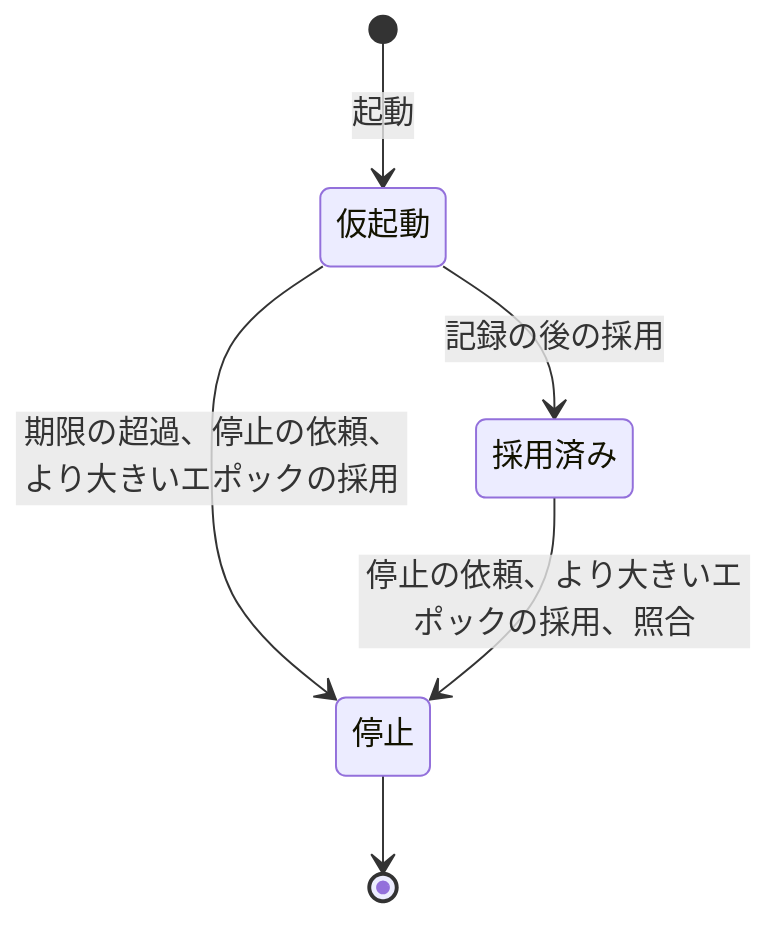

# ランチャーはノードごとの独立したプロセスで、Assignee をコンテナで仮起動し、記録の後に採用する

- Status: Accepted
- Date: 2026-11-20
- Related: #196、#197、#263

配置表へのアドレスの記録の前に App server が終了すると、起動済みの Assignee が残存する。この問題に対し、ノードごとの独立したランチャーが Assignee をコンテナで仮起動する方式を採用した。App server は記録の後に Assignee を採用し、期限までに採用されない Assignee はランチャーが停止する。App server の子プロセスにする案、リースの定期的な更新、アイドルによる終了で回収する案は不採用とした。ランチャーは PostgreSQL への接続も状態の保持もせずに残存を回収できる。一方、オンプレ環境での Docker の必須化と、複数ノードにした時点での残存の可能性を受け入れた。

## Context

[ADR 0012](0012-placement-table-issues-epochs-and-a-process-serves-one-epoch.md) は、[配置表](../../GLOSSARY.md)(PostgreSQL のワークスペースごとの1行)が[エポック](../../GLOSSARY.md)を発行し、1個の [Assignee](../../GLOSSARY.md) のプロセスは1個のエポックだけを処理する、と決定した。App server はエポックを発行してから、[ノード](../../GLOSSARY.md)の[ランチャー](../../GLOSSARY.md)に Assignee の起動を依頼する。Assignee の準備を確認した後に、そのアドレスを配置表に記録し、以後の要求を記録したアドレスへ転送する。同一のエポックのプロセスを2個起動しないために、App server は結果が不明な起動の依頼を再送しない。ランチャーは PostgreSQL と S3 のどちらにも接続しない。PostgreSQL の認証情報を App server だけに配布するためである。

ADR 0012 の最初の実装では、ランチャーは App server 内にあり、Assignee を子プロセスとして起動した。この構成では、App server の再起動で全 Assignee が停止する。記録の前に App server が終了した場合の残存も、この全停止で回収していた。issue #196 の目的は、人の手作業による Assignee の起動を、App server の指示による起動に置き換えることである。記録前の残存は、独自の永続的な台帳なしで回収する。

本文の用語は以下のとおりである。

- 仮起動: ランチャーが Assignee を起動し、期限を設定した状態。
- [採用](../../GLOSSARY.md): 配置表への記録の後に、App server が仮起動の Assignee を引き受けること。期限が解除される。
- 起動期限: エポックの発行から記録までに許容する時間。App server が配置表の行から計算する(ADR 0012)。
- 期限: 仮起動の Assignee を採用なしで稼働させる時間。起点はコンテナの作成時刻で、長さは App server が起動期限以上の値を指定する。
- 照合: ランチャーが Docker の全コンテナを検査し、停止すべき Assignee を停止する処理。

## Decision

- **ランチャーは、ノードごとに1個の独立したプロセスである**。 App server の再起動と更新で、Assignee は停止しない。ランチャー自身の終了と再起動でも、Assignee のコンテナは稼働を継続する。【未検証】
- **Assignee は、1個ずつ Docker のコンテナで起動し、再起動の方針を `no` にする**。 同一のエポックのプロセスを再起動すると、1個のプロセスが1個のエポックだけを処理する規則(ADR 0012)に違反するからである。コンテナごとにメモリの上限を設定する。【未検証】
- **ランチャーの契約は、起動、採用、停止の3操作である**。 ADR 0012 の、稼働中のプロセスを検索する操作(`Find`)は持たない。【未検証】
  - 起動(`Start`)は、WorkspaceGlobalId、エポック、期限の長さを受け取り、Assignee を仮起動して、listen 中のアドレスとコンテナの識別子を返却する。期限の長さは App server が起動期限以上の値を指定し、ランチャーはコンテナの作成時刻を起点に自分の時計だけで計測する。
  - 採用(`Confirm`)は、仮起動の Assignee を採用する。同時に、同一ワークスペースのより小さいエポックの Assignee を、同一ノードの範囲で全部停止する。何回送信しても結果は同一である。対象のコンテナが稼働していない場合は失敗する。
  - 停止(`Stop`)は、指定したエポックの Assignee を、状態を問わず停止する。
  - 通信の自動再試行は、3操作のすべてで無効にする。採用は結果が同一なので、App server が明示的に再送してよい。停止は失敗しても再送しない(ADR 0012)。
- **App server は、配置表へのアドレスの記録の後に採用を依頼する**。 記録と採用の間に依頼元の App server が終了した場合に備え、記録済みで未採用のアドレスへ転送する App server も、採用を依頼する。採用が失敗した場合は、記録済みの Assignee を不在と判定して交代を開始する。記録の前に採用すると、記録が失敗した場合でも、配置表の行が指示する Assignee (より小さいエポック) を採用が停止しうるからである。【未検証】
- **期限までに採用されない仮起動の Assignee は、ランチャーが停止する**。 期限の判定と採用はワークスペースごとに直列化し、停止を決定した後の採用は失敗させる。ランチャーは起動時と一定の間隔で照合する。照合は、期限を超過した仮起動の Assignee を停止する。同一ワークスペースでノード内の採用済みの最大のエポックより、小さいエポックの Assignee も停止する。【未検証】
- **ランチャーは状態を自分で保持せず、Docker のコンテナの属性に保存する**。 WorkspaceGlobalId、エポック、期限の長さ、採用の有無をコンテナに保存し、ランチャーの再起動後は Docker のコンテナの一覧から管理を復元する。同一の WorkspaceGlobalId とエポックのコンテナが存在すれば、状態を問わず起動を拒否する。【未検証】
- **同一のエポックの起動を累計1回にする保証は、システム全体で成立させる**。 App server は起動を再送しない(ADR 0012)。通信の自動再試行と、1個の依頼からのコンテナの作成と起動の再実行を禁止する。結果が不明な起動は再実行せず、期限で回収する。ランチャーは消費済みのエポックを記録しない。再送の禁止を外すと、同一のエポックのプロセスが2個起動する。【検査】
  - ラベルによる重複の拒否は、削除前のコンテナにしか作用しない。削除の後に到着した依頼は拒否できないので、重複の拒否があっても再送の禁止は省略できない。【未検証】
  - PostgreSQL の切り替えで同一のエポックが再発行される場合は例外である。変更ログの整合性は、フェンス(S3 の Slot への条件付きの書き込みで、プロセスの識別子を保持する)が保証する(ADR 0006、ADR 0012)。【検査】

範囲外: 配置表、エポックの発行、準備の確認、アドレスの記録の規則(ADR 0012)。稼働中のプロセスの検索と、ほかの App server による記録の代行。App server とランチャーの間の認証。複数ノード(#240)。アイドルによる終了(#237)。同一のエポックの2個目のプロセスの回収(フェンスによる自己停止に任せる)。メモリの上限値と、上限の合計による起動の受け入れ(#196)。

検証: 実装は存在しない。モデルの検査は `storage/quint/check.sh` が実行する。再送の禁止を外した `placement_start_resent` は、`epochStartsOneProcess` に違反する。切り替え時の整合性は `placement_failover` が検査する。仮起動、採用、照合のモデル化と試験は #196 で追加する。守る不変条件は次の2個である。

- 採用と照合は、配置表の行が指示する Assignee と、採用済みの最大のエポック以上の Assignee を停止しない。
- 同一のエポックのプロセスの起動は、累計1回である。

## Alternatives Considered

App server 内で子プロセスを起動する: App server の更新で全 Assignee が停止し、コンテナへの移行で実装が廃棄になる

ADR 0012 の最初の実装である。App server の再起動による全停止で、記録前の残存を回収できる。しかし App server の更新のたびに全ワークスペースが停止からの起動になる。親の終了の通知(`PR_SET_PDEATHSIG`)とゾンビの回収の実装も必要で、コンテナへの移行でこれらは全部廃棄になる。

App server 内のランチャーが Docker を操作する: 1個のプロセスに PostgreSQL と Docker の権限が集中し、二重起動で相互のコンテナを削除する

ランチャーとの通信の契約の決定を延期できる。しかし1個のプロセスが PostgreSQL の認証情報と Docker のソケットの権限を保持し、ADR 0012 の分離に反する。App server が二重に起動すると、相互のコンテナを残存と判定して削除する。

配置表を採用の正にし、ランチャーが期限の時点で参照する: ランチャーが PostgreSQL に接続する

採用の依頼が不要になる。しかしランチャーに PostgreSQL の認証情報が必要になり、ADR 0012 の分離に反する。

記録のたびに、記録したエポックより小さいエポックを停止する: 記録の後に要求がないワークスペースで、記録前の残存を回収できない

仮起動の期限が不要になる。しかし停止の契機が記録だけなので、App server が記録の前に終了し、その後に要求がないワークスペースでは、残存した Assignee が停止しない。

リースを定期的に更新する: App server が停止すると、全 Assignee が停止する

App server が Assignee ごとのリースを更新し、ランチャーは更新が途絶えた Assignee を停止する。App server の停止や更新の遅延が、健全な Assignee の全停止になる。ADR 0012 は時計の精度を前提にするリースを導入しないと決定している。

アイドルによる終了で回収する: 回収がアイドルの期限に依存し、10億セル級のワークスペースを対象外にする指定も必要になる

残存した Assignee は要求を受領しないので、アイドルの期限で終了する。しかし残存の回収をアイドルの期限に依存させない(#237)。読み込みに時間を要する10億セル級のワークスペースはアイドルで停止させないので、その指定も必要になる。

ランチャーが消費済みのエポックを記録する: ランチャーの再起動で記録が消失し、切り替えの例外も防止できない

遅延して到着した起動の依頼を、ランチャーが拒否できる。しかし記録はランチャーの再起動で消失し、永続化すると独自の台帳になる。PostgreSQL の切り替えによる同一のエポックの再発行も防止できない。遅延した起動は期限で回収できる。

## Consequences

- オンプレ環境の必須構成に Docker が加わる。起動、採用、期限は Docker の機能でなく契約の意味として定義したので、ほかの実行環境(Kubernetes の Pod など)による実装も可能である。
- 残存する時間の上限は、期限、照合の間隔、停止の猶予の和である。ランチャーの停止中は、復旧までの時間が加算される。
- 稼働中のプロセスを検索する操作がないので、PostgreSQL の切り替えで後退したエポックの回復は、エポック1個ごとに起動期限の超過を待機する。ほかの App server による記録の代行もできない。
- 採用が停止するのは同一ノードの Assignee だけである。複数ノードでは、停止の依頼が喪失すると、採用済みの Assignee が残存する(#240)。
- 未解決: 照合の間隔とメモリの上限値は未決定である。Docker のコンテナの属性の不変性、名前の変更の原子性、`connectrpc` のクライアントで自動再試行を無効にできるかは未確認である(#196)。

見直す条件: 複数ノードにする時点(#240)。仮起動、採用、照合をモデルに追加して性質に違反した場合。切り替え後の回復の待機を許容できなくなった場合。ほかの App server による記録の代行が必要になった場合。Docker 以外の実行環境を必須にする顧客が現れた場合。
